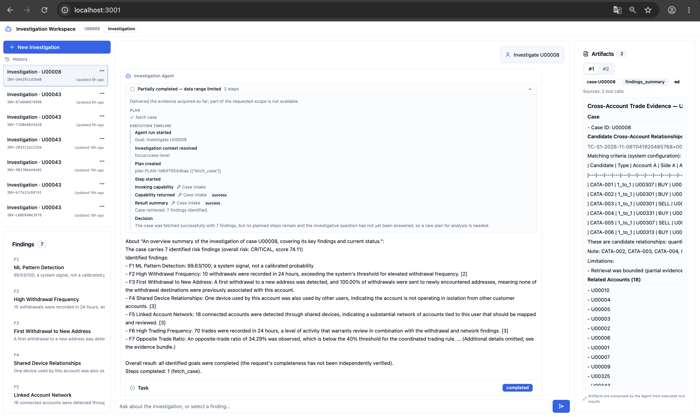
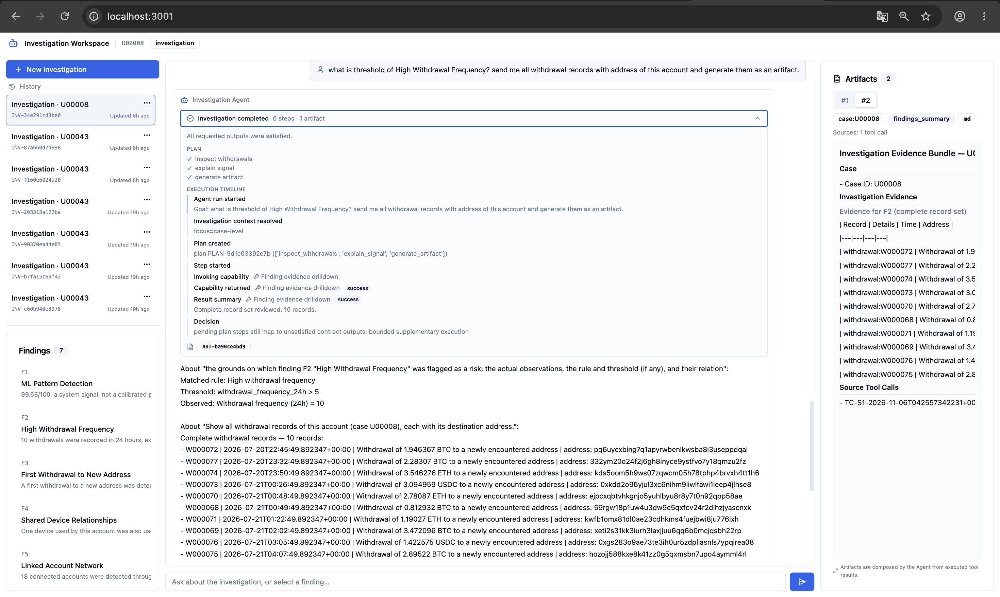
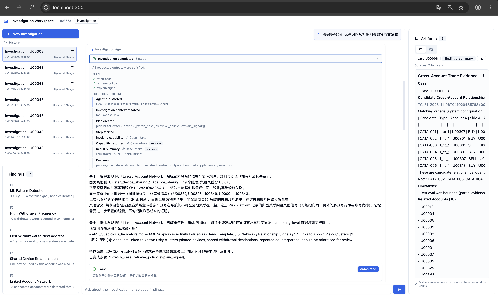
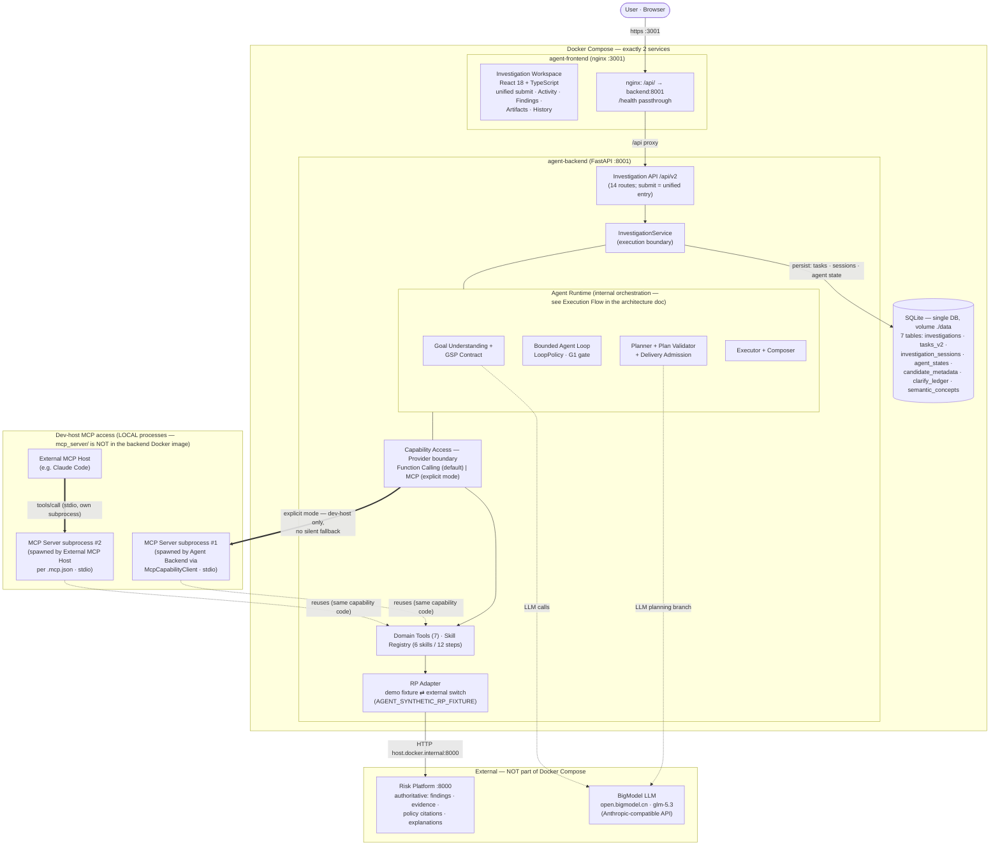

# Investigation Agent Client

## 1. Project Overview

A **case-centered investigation agent for risk analysts** — a focused
workspace where an analyst opens a case, investigates its findings through
conversation, and produces provenance-traceable investigation artifacts.

- It runs **on top of an existing Risk Platform**, which remains the
  authoritative source for risk signals, evidence, policy citations, and
  case explanations. The Agent Client adds the investigation layer:
  goal understanding, planning, constrained execution, context, and scoped
  outputs.
- This is an **open-source MVP** with a complete core user journey — not a
  production deployment system (no TLS, no auth gateway, no secret
  manager; see the Docker operations guide's NOT SUPPORTED section).
- The Risk Platform is an **external dependency** (separate repository,
  never part of this project's Docker Compose stack). A bundled synthetic
  **Demo mode** lets the stack run without it.
- Selected investigation capabilities are also exposed through **MCP** for
  reuse by the Agent Runtime and external MCP Hosts.

## 2. What It Does

| Capability | Example request |
|---|---|
| Case intake | "Investigate U00299" |
| Focus Mode | select a finding (F1, F2, …) in the Findings panel |
| Timeline investigation | "Show the timeline for this finding." |
| Withdrawal investigation | "Show me all the withdrawals." |
| Transaction investigation | "Show me all the transactions." |
| Cross-account trade analysis | "Analyze the opposite-trade relationships in this case." |
| Related-account analysis | "Which accounts are related to this one?" |
| Signal explanation | "Why is this finding flagged?" |
| Policy retrieval | "Which policy requirements apply?" |
| Artifact generation | "Generate a Markdown investigation bundle." |
| Suggested next steps | follow-up chips attached to each Agent response |

Core invariants:

- **One Investigation = One Case.** A request naming a different case
  gets bounded guidance to start a new investigation — never silent
  re-targeting.
- **Outputs are bounded and honest.** Unsupported operations,
  insufficient evidence, and unresolved references produce explicit,
  distinctly-worded bounded outcomes — the system never silently
  substitutes unrelated evidence or fabricates a plausible answer.

## 3. See It First

Real workspace runs against the external Risk Platform — full workbench
in each shot (left: History / Findings · center: conversation with the
inline Agent Activity trace · right: Artifacts). The runs show natural
bilingual interaction: analyst requests in Chinese, structured evidence
and artifacts in English.

### 1. Case Fetch



Retrieve the authoritative case context and findings from the external
Risk Platform as the investigation's starting point (Case Intake).

### 2. Evidence-based Investigation



Investigate a focused finding's evidence streams (withdrawals,
transactions) through evidence-oriented tool execution, then generate a
provenance-traceable investigation artifact from the executed results.

### 3. Multi-tool Investigation



A focused compound investigation coordinating multiple domain tools —
evidence drilldown, signal explanation, cross-account trade analysis,
related-account analysis, and artifact generation — consolidating the
findings into one investigation report.

## 4. Agent Workflow

One investigation request, end to end (the full diagram lives in the
[architecture doc §2](docs/architecture/AGENT_CLIENT_ARCHITECTURE_V2.md#2-investigation-execution-flow)):

1. **Submit** — every user request (simple, compound, follow-up click, or
   the first Case Intake) enters through the single unified endpoint and
   runs on the bounded Agent Loop.
2. **Goal Understanding** — one real-LLM pass (with a deterministic
   heuristic fallback when the LLM is unavailable) interprets the request
   and proposes a goal contract; a deterministic builder is the only
   acceptance gate.
3. **Target validity gate (G1)** — LLM-proposed target bindings without
   deterministic supporting evidence are blocked before any
   finding-level tool runs.
4. **Context & Skill** — conversational references resolve
   deterministically first; the skill registry narrows what can be
   planned to capability-gated skills.
5. **Planning** — deterministic contract-proposal branches handle known
   request shapes; free-form requests use LLM planning strictly inside
   the selected skill's step vocabulary. The Plan Validator
   (`check_plan`) is the final authoritative gate.
6. **Delivery admission** — per-target admission runs after the plan is
   final and before any execution: invalid delivery targets are stripped,
   valid ones get binding injections, all-invalid runs stop with a
   clarification (zero execution).
7. **Execution & loop** — the system-controlled executor calls domain
   tools (Risk Platform evidence, explanations, policy) through Function
   Calling or MCP; the LoopPolicy — not the LLM — decides continue /
   re-plan / stop within a bounded iteration budget.
8. **Answer & persistence** — every terminal (including blocked, partial,
   and bounded outcomes) gets an honest composed answer; tasks, plans,
   tool calls, artifacts, and session state persist to SQLite, so
   refreshing the page or reopening from History restores everything.

**Division of labor**: the LLM participates in goal understanding and
constrained planning proposals; deterministic code owns target validation,
plan validation, parameter locks, tool routing, iteration limits, and
termination. The system is never described as — and never behaves as —
an LLM autonomously running the investigation.

## 5. Architecture



- **Docker Compose contains exactly two services**: `agent-frontend`
  (nginx, static build + `/api` reverse proxy) and `agent-backend`
  (FastAPI). The LLM, the Risk Platform, and both MCP paths are
  **outside** Compose.
- **MCP is a local stdio access path, not a Compose service**: the Agent
  Runtime spawns its own MCP Server subprocess via
  `McpCapabilityClient` (explicit execution mode; Function Calling is the
  default and there is no silent fallback), and an external MCP Host
  (e.g. Claude Code) spawns a second, independent server subprocess via
  the project-level `.mcp.json`. Both subprocesses run the same
  `mcp_server/server.py` adapter over the same domain capability. The
  runtime MCP path is **dev-host only** — `mcp_server/` is not copied
  into the backend Docker image. See
  [MCP_ARCHITECTURE_V1.md](docs/architecture/MCP_ARCHITECTURE_V1.md)
  (three-level validation record).
- Internal runtime execution order is deliberately **not** in this
  diagram — see the
  [Execution Flow diagram](docs/architecture/AGENT_CLIENT_ARCHITECTURE_V2.md#2-investigation-execution-flow).

## 6. Verified Capabilities

Evidence legend — **E2E**: exercised end-to-end on the real stack ·
**RT**: reachable in the running product · **IMPL**: implemented in code
· **API-E2E**: verified at the real-API level · **NOT PROVEN**: designed
and unit-tested, no field-level acceptance evidence yet.

| Capability | Level | Evidence |
|---|---|---|
| External RP browser journey: create → intake → compound goal → Findings vs live RP → Artifact content → refresh → History reopen (real Chrome, real BigModel LLM, no mocks) — 15/15, zero console/network errors | E2E | [2026-11-08 acceptance report](docs/qa/2026-11-08-external-browser-e2e-acceptance-v1.md) |
| Docker build/start/health/proxy/persistence; Demo-mode browser journey; data-source isolation (409 cross-mode) | E2E | [Docker operations guide](docs/operations/DOCKER_DEPLOYMENT_AND_OPERATIONS.md) (Phase 3A/3B rounds, 2026-11-06) |
| Goal Understanding with real LLM (plus deterministic heuristic fallback) | E2E | 2026-11-08 run `INV-cd791b211660`; BigModel D3 round |
| GSP goal-semantic contract (deterministic proposal → LLM review → acceptance) — ON by default | E2E | [FEATURE_FLAG_INVENTORY](docs/architecture/FEATURE_FLAG_INVENTORY.md) §1; per-feature reports in `docs/qa/` |
| G1 target-validity gate — safe blocking + no false interception | E2E | flag inventory §6 (2026-11-03 ON round). Note: the UNGROUNDED / INVALID / AMBIGUOUS branch field evidence is **NOT PROVEN** (unit-level only) |
| Planner deterministic contract-proposal branches | E2E | B-chain / GSP acceptance rounds in `docs/qa/` |
| Planner LLM-planning branch (free-form, skill-scoped) | IMPL + RT | implemented in `planner_v2.py`; the Week 1 planner evaluation (27/30) is a **historical baseline**, not current acceptance |
| Function Calling tool chain | E2E | every accepted journey |
| MCP access — 3 levels (test client; runtime provider; external host Claude Code) | E2E | [MCP_ARCHITECTURE_V1.md](docs/architecture/MCP_ARCHITECTURE_V1.md) |
| Persistence & restore (refresh, reopen-from-history, resume endpoint) | E2E (refresh/reopen) · API-E2E (resume) | 2026-11-08 report; P4 resume round |

Post-Week-1 acceptance is documented per feature in `docs/qa/` — this
table links the headline entries, not every round.

## 7. Quick Start

### Docker (default path)

Prerequisites: **Docker Desktop or Docker Engine 20.10+** (with Compose
v2). A running **Risk Platform** is only needed for the External RP
mode (see below) — the default **Demo mode needs no RP**.

```bash
# 1. Configure environment (never commit .env)
cp .env.example .env
#   - ANTHROPIC_API_KEY       → your own API key (optional for a first
#     look; required for real LLM investigation turns). Preset endpoint
#     is Zhipu BigModel's Anthropic-compatible API with model glm-5.3 —
#     replace both if you use a different provider.
#   - RISK_PLATFORM_BASE_URL  → only needed in External RP mode.

# 2. Build and start — DEFAULT = Demo mode (no Risk Platform needed)
docker compose up --build -d

# 3. Stop (investigation data persisted under ./data/ is kept)
docker compose down
```

**Demo mode (default).** With `AGENT_SYNTHETIC_RP_FIXTURE` unset, the
backend serves a bundled **fully synthetic** risk case `U99001` — no
Risk Platform required. Open `http://localhost:3001`, create an
investigation for `U99001` (e.g. submit `Investigate U99001`), and
exercise the Agent: findings, evidence retrieval, Artifact generation.
Demo data is fabricated and marked synthetic — it is **not** real Risk
Platform evidence, and Demo mode is not a production architecture.
Without an API key the run uses deterministic fallbacks (bounded,
honest outputs — not real LLM reasoning); add your key for real model
calls.

**External RP mode.** For real Risk Platform integration, set in your
`.env`: `AGENT_SYNTHETIC_RP_FIXTURE=` (**explicitly empty** — disables
Demo) and `RISK_PLATFORM_BASE_URL=<your RP URL>` (from the container,
`http://host.docker.internal:8000` reaches a host-local RP). Keep the
RP running; the Agent reads it through the same adapter. Caution:
shell-exported variables override `.env` — if your shell exports
`ANTHROPIC_BASE_URL` or `AGENT_SYNTHETIC_RP_FIXTURE`, clear them or
the `.env` values will not apply. Investigations remember which data
source created them: opening an investigation under the other mode and
continuing it returns a clear 409 (viewing history is always allowed).

- Frontend: `http://localhost:3001`
- Backend: `http://localhost:8001` (health: `/health`; the compose
  healthcheck uses the same route)

**Data location:** investigation records are stored in
`./data/investigation_agent_v2.db` (SQLite, bind-mounted to the backend
container). Data survives `docker compose down` and container
recreation — deleting the `./data/` directory resets all records.

Full deployment topology, data/backup procedures, troubleshooting, and
verified-capability status:
[DOCKER_DEPLOYMENT_AND_OPERATIONS.md](docs/operations/DOCKER_DEPLOYMENT_AND_OPERATIONS.md).

### Local development (second path)

Prerequisites: Python 3.12, Node 20, a running **Risk Platform** on
`localhost:8000` (external dependency, separate repository), and LLM
credentials.

```bash
# 1. Backend (port 8001)
cd backend
python -m venv .venv && source .venv/bin/activate
pip install -r requirements.txt
uvicorn app.main:app --host 127.0.0.1 --port 8001

# 2. Frontend (port 3001, proxies /api → localhost:8001)
cd frontend
npm install
npm run dev
```

Configure LLM credentials in `backend/.env` (see
`backend/.env.example`): `ANTHROPIC_API_KEY`, `ANTHROPIC_BASE_URL`,
`ANTHROPIC_MODEL`.

### Evaluation commands

```bash
cd backend

# Runtime Semantic Evaluation (deterministic, scripted planner, stubbed RP)
python -m eval.run_eval --mode scripted
python -m eval.run_eval --mode live            # real RP + real LLM
python -m eval.run_eval --mode scripted --category evidence
python -m eval.run_eval --mode scripted --scenario E07

# Planner Evaluation (real configured LLM, 3 runs per scenario)
python -m eval.run_planner_eval --runs 3
python -m eval.run_planner_eval --scenario P08

# Unit / regression suites
python -m pytest tests/ -q
```

## 8. Tech Stack

| Layer | Technologies |
|---|---|
| Backend | Python 3.12, FastAPI, Pydantic v2, Uvicorn, httpx |
| Frontend | React 18, TypeScript, Vite, Tailwind CSS, Radix UI, nginx (prod) |
| Agent runtime | PlannerV2 (deterministic branches + constrained LLM planning), ExecutorV2, bounded Agent Loop, GSP contract system, domain tools |
| Persistence | SQLite — single database, TaskStoreV2 (7 tables), volume-mounted `./data/` |
| Evaluation | deterministic framework (`backend/eval/`), pytest |
| MCP | MCP Client / Server (stdio) |
| Deployment | Docker, Docker Compose (2 services), nginx reverse proxy |

## 9. Documentation

| Document | Content |
|---|---|
| [AGENT_CLIENT_ARCHITECTURE_V2.md](docs/architecture/AGENT_CLIENT_ARCHITECTURE_V2.md) | current architecture: system overview + execution flow + components (single source of truth) |
| [DOCKER_DEPLOYMENT_AND_OPERATIONS.md](docs/operations/DOCKER_DEPLOYMENT_AND_OPERATIONS.md) | deployment topology, modes, persistence, verified-capability status |
| [FEATURE_FLAG_INVENTORY.md](docs/architecture/FEATURE_FLAG_INVENTORY.md) | feature-flag ledger: defaults, governance history, acceptance status |
| [MCP_ARCHITECTURE_V1.md](docs/architecture/MCP_ARCHITECTURE_V1.md) | MCP access path: server, client, provider, three-level validation |
| [API_CONTRACT_V1.md](docs/architecture/API_CONTRACT_V1.md) | Week 1 HTTP contract snapshot (current endpoint list: architecture doc §8) |
| [DOMAIN_MODELS_V1.md](docs/architecture/DOMAIN_MODELS_V1.md) | domain model contract (Finding, capabilities, Plan, ToolResult, …) |
| [SKILL_MODEL_V1.md](docs/architecture/SKILL_MODEL_V1.md) | skill registry, step vocabulary, step→tool bindings |
| [FOLLOW_UP_MODEL_V1.md](docs/architecture/FOLLOW_UP_MODEL_V1.md) | suggested follow-ups contract |
| [AGENT_RESPONSE_EVIDENCE_PRINCIPLES_V1.md](docs/architecture/AGENT_RESPONSE_EVIDENCE_PRINCIPLES_V1.md) | P1–P20 engineering principles |
| [AGENT_EVALUATION_V1.md](docs/architecture/AGENT_EVALUATION_V1.md) | evaluation methodology (Week 1 baseline + post-Week-1 pointers) |
| `docs/qa/` | per-feature acceptance reports (most recent: the 2026-11-08 External RP browser E2E) |

Internal QA/acceptance records are mixed-language (English/Chinese) —
they are process documents, not product documentation.

## 10. Why This Is an Agent

A request is mapped to a structured goal and plan, executed against
domain tools, and answered from structured results. The division of
labor is explicit:

- **Goal Understanding** runs one real-LLM pass (with a deterministic
  heuristic fallback when the LLM is unavailable) before execution.
- **Planning** combines deterministic contract-proposal branches with
  LLM planning inside the selected skill's vocabulary.
- The deterministic **Plan Validator** (`check_plan`) is the final
  authoritative gate; **Delivery Admission** bounds what each run may
  claim to deliver; and the bounded **Agent Loop** — iteration limits,
  tool routing, termination — is enforced by the system, never by the
  LLM.
- Outputs are **evidence-grounded**: every claim traces to a logged tool
  result from the authoritative Risk Platform; the Planner never
  invents authoritative attributes (detector identity, for example, is
  derived at runtime from the focused finding's `signal_refs`).

| Natural-language request | Planned operation |
|---|---|
| "Why is this finding flagged?" | `explain_signal` |
| "Show me all withdrawals." | `inspect_withdrawals` |
| "Show me all transactions." | `inspect_transactions` |
| "Show me the opposite trade." | `inspect_self_opposite_trades` |

Intent recognition is distinct from runtime capability: opposite-trade
investigation may be bounded as unsupported for a given finding — but
the Planner still recognizes it as that operation instead of silently
substituting generic evidence.

Core engineering principles (details:
[AGENT_RESPONSE_EVIDENCE_PRINCIPLES_V1.md](docs/architecture/AGENT_RESPONSE_EVIDENCE_PRINCIPLES_V1.md),
P1–P20):

1. Composition, not computation — responses and artifacts are
   deterministic compositions of already-produced tool results.
2. The Risk Platform owns findings, scores, evidence, and citations;
   the Agent normalizes and presents.
3. Capability-gated behavior — operations run only when the focused
   finding supports them.
4. Case/finding scope separation for outputs.
5. Task completion ≠ semantic success — acceptance asserts semantic
   outcomes.
6. Bounded honesty — empty, unsupported, unresolved, and unavailable
   are distinct, explicit outcomes.
7. Traceable structured execution — every turn records its plan, tool
   calls, results, and artifacts.

## 11. Evaluation & History

> **HISTORICAL BASELINE** — the figures in this section are the **Week 1
> baseline** (September 2026, commit `1626df2`, frozen as *"feat: freeze
> week 1 agent runtime and evaluation"*). They are a historical snapshot
> of the project's first milestone, **not** the current version's
> acceptance record. Current acceptance is the per-feature evidence in
> §6 and `docs/qa/`.

| Check (Week 1 baseline) | Result |
|---|---|
| Backend tests | 757 passed, 1 skipped, 1 xfailed, 0 failed |
| Runtime Semantic Evaluation | 15/15 — 100% |
| Planner Evaluation (10 scenarios × 3 real-LLM runs) | 27/30 runs — 90.0%; 9/10 scenarios perfectly stable |
| Live E2E Evaluation | 5/5 — 100% |
| Frontend | TypeScript clean; Vite build passed |

The three evaluation layers (Runtime Semantic / Planner / Live E2E,
never merged into one score) remain the evaluation philosophy; the
framework has since grown (AL-3 harness, LLM judge) — see
[AGENT_EVALUATION_V1.md](docs/architecture/AGENT_EVALUATION_V1.md) §14a.

## 12. Known Limitations

- **P09 (known Planner limitation, intentionally retained):** the
  compound request *"Switch to finding F2 and show me its timeline."*
  produced 0/3 valid plans (`INVALID_LLM_OUTPUT`) in the Week 1 Planner
  Evaluation — a limitation for compound requests combining focus
  switching with a follow-up operation. The focus/context mechanism
  itself works, and downstream safety was never compromised.
- The Planner's **LLM-planning branch has implementation + runtime
  evidence but no current E2E acceptance round of its own**; the
  deterministic branches do.
- The G1 gate's UNGROUNDED / INVALID / AMBIGUOUS branches are
  unit-verified; their real-API/browser field evidence is **NOT PROVEN**
  (flag inventory §6).
- Opposite-trade investigation: the self-opposite view is implemented
  (`inspect_self_opposite_trades`); the cross-account views report
  candidate relationships only — confirmation is a separate
  investigative act.
- No persistent production telemetry store; the telemetry contract and
  no-op/in-memory sinks are the implemented scope.
- The Risk Platform is required and external; the Agent cannot produce
  investigation results without it (Demo mode serves synthetic data).
- **Known failing tests (documented, not yet fixed):** the bilingual
  coverage suites carry pre-existing failures — a None-format rendering
  family in the zh hedge-candidates/evidence renderer
  (`tests/test_display_cap_disclosure_v1.py`: the five
  `TestGspCandidateCapDisclosure` overflow shapes plus
  `TestFoundEmittedPartialSemantics::test_gsp_header_discloses_undelivered`;
  `tests/test_generality_invariants_v1.py::test_renderer_never_leaks_none_for_time_gap`),
  and one completion-semantics failure
  (`tests/test_three_constraints_closure_v1.py::test_contract_path_renders_per_output_not_generic_guard`).
  Additionally, one outdated assertion
  (`tests/test_display_cap_disclosure_v1.py::TestRecordTableMarker::test_record_table_overflow_has_marker`)
  was left behind by the records-listing disclosure-semantics fix. All
  of these are attribution-verified against a pre-batch isolation copy
  and remain open follow-up items — not silently treated as resolved.
