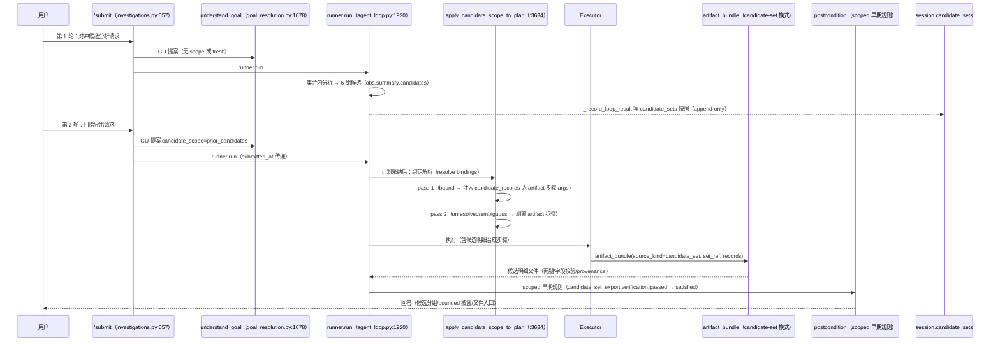

# Context and Cross-Turn State — Design V1（上下文分类与跨轮次状态设计）

Status: **IMPLEMENTED / E2E-VERIFIED (main journey, 2026-10-29)。**
边界: 本文档只覆盖「跨轮候选交易回指导出」闭环（计划 v2.1 已批准范围）。
不覆盖: 通用记忆系统、并发写入原子性、其他 case 的候选字段普遍性、
模型端点 token 行为、S4 Planner 措辞能力缺口。

源码基线（本文撰写时）: `agent_loop.py`（scope_bindings、
`_resolve_candidate_scope_bindings`、`_apply_candidate_scope_to_plan`）、
`goal_resolution.py`（`RequiredOutput.candidate_scope`、提案解析、prompt）、
`goal_postconditions.py`（scoped 早期规则、`_claim_references_prior_detection`）、
`api/investigations.py`（`submitted_at`、candidate_sets 快照）、
`domain_tools/artifact_bundle.py`（candidate-set 渲染 + provenance）。

---

## 1. Context 分类与生命周期

| 类别 | 载体 | 生命周期 | 写入方 | 备注 |
|---|---|---|---|---|
| 会话上下文（focus/case 绑定） | `investigation_sessions.document.context` | 调查会话存续期；刷新/重启后恢复 | `_apply_context_action` + `_save_context` | 用户显式选焦唯一可写面（QA-01） |
| 每轮执行状态 | `agent_states`（TaskStoreV2 行 + 文档） | 单轮生命周期，终态持久化 | `_persist` | `plan_steps` 镜像在计划采纳/重规划时按 `plan.steps` 序列化（agent_loop:4330-4343） |
| 候选集快照（本轮新增） | `investigation_sessions.document.candidate_sets[]` | 会话存续期，append-only 不可变快照 | `_record_loop_result`（唯一写入方） | 失败不落条目；后续引用按 F3 安全失败 |
| 产物 | `investigation_sessions.document.artifacts[]` + ArtifactV2 | 会话存续期 | executor harvest + `_record_loop_result` 镜像 | `source_tool_calls` min_length=1 溯源不变量 |
| GU 诊断 | `agent_states.goal_understanding_diagnostics` | 单轮，终态持久化 | run() 决策块 | 含 submitted_at / GU 窗口 / outcome / attempts 墙钟 |

## 2. 职责边界

- **GU（understand_goal）**: 意图分类（goal_resolution/goal_type）+ 候选范围
  意图标注（`candidate_scope: prior_candidates|fresh|None`，提案 schema 封闭
  枚举，未知识别值归一化 None）。**不解析**回指指向哪个前序集合——解析是
  会话层确定性职责。
- **Agent Loop（run/_run_loop）**: 契约接受 → `_resolve_candidate_scope_bindings`
  （显式 CS-ref > 唯一集合 > 多集 ambiguous > 无集 unresolved）→
  `_apply_candidate_scope_to_plan`（bound → 注入 candidate_records；
  unresolved/ambiguous → 剥离 artifact 步骤）→ 执行 → postcondition。
- **Plan**: 执行蓝图；`step_output_map` 是 scoped 剥离/注入的定位依据。
- **Executor**: 按（可能已被注入的）step arguments 调用工具；不做范围判定。
- **domain tool（artifact_bundle）**: candidate-set 模式确定性渲染 +
  字段完整性校验（缺失即拒导出，无成功标记文件）+ provenance（min_length=1）。
- **postcondition**: scoped 输出仅可由 verified candidate_set_export +
  artifact 满足；否则 partial + 命名缺口（F6 守卫：claim 回指 + 无候选集
  证据 → 永不 satisfied）。

**LLM 与确定性边界**: LLM 只做意图分类与范围标注（candidate_scope 字段）；
绑定、注入、剥离、范围校验全部确定性。裸关键词永不单独触发继承
（F6 守卫阻止）。

## 3. 数据流（Mermaid，与源码一致）

## 4. 已验证能力（真实栈，2026-10-29）

| 项 | 证据 | 状态 |
|---|---|---|
| 第 1 轮 6 组候选/12 tid 持久化 | INV-040e230d51f5 candidate_sets | VERIFIED |
| 回指导出绑定 → 注入 → 候选明细文件 12 tid 精确相等 | ART-43e42bf8dc | VERIFIED |
| scoped postcondition（verification.passed → satisfied） | 单测 + 真实栈 | VERIFIED |
| F6 守卫（claim 回指 + 无候选集证据 → partial） | 单测 + A 场景真实栈 | VERIFIED |
| 零候选 → UNRESOLVED 如实报告 | 单测 + INV-fbb38c4a8d89 A 轮 | VERIFIED |
| 换题零继承（bindings None） | S4 场景 | VERIFIED |

## 5. 未验证能力

- 明确换题的新目标规划（S4 场景规划失败，既有 planner 缺口）——NOT VERIFIED。
- 多集合澄清的浏览器交互旅程——NOT RUN。
- F3 原引用不存在→重新分析→确认导出的完整真实栈闭环——单测钉死语义，真实栈 NOT RUN。

## 6. 已知残余风险

- 会话文档并发写入原子性（既有模式，NOT PROVEN）。
- 候选 supporting 字段在其他 case 的普遍完整性（单案例已验，不外推）。
- 端点对 >8192 预算行为（延续 NOT PROVEN）。
