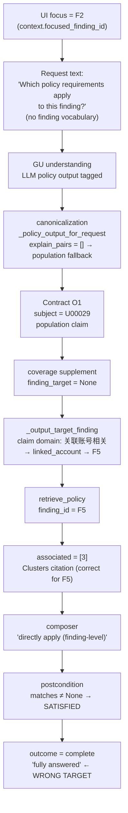
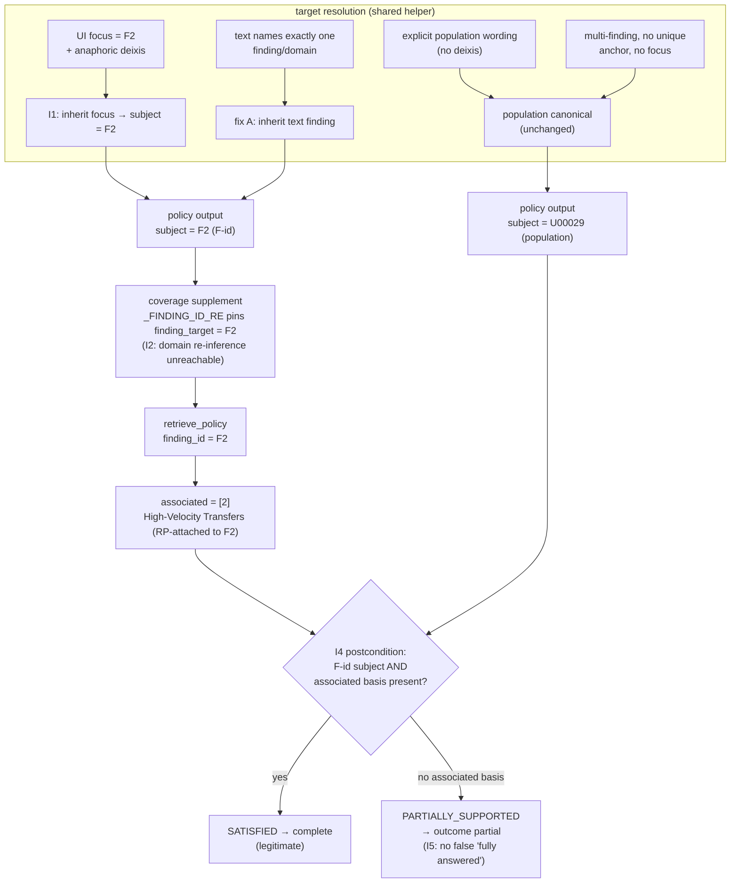

# Policy Applicability End-to-End Closure — Anaphoric Policy Questions, Target-Provenance Invariants, and Applicability-Aware Completion

Status: **COMPLETE (2026-10-26)** — implemented and verified within the
authorized scope (deterministic target resolution, applicability-aware
completion, regression and live end-to-end evidence). Residual risks that
remain outside the authorized scope are recorded in §9 and are **not**
covered by the COMPLETE status. This document is the durable engineering
record of the incident, the root-cause analysis, the cross-module
invariants introduced by the fix, and the verification evidence. It
follows the record conventions of
`docs/architecture/L1_RECORDS_DELIVERY_PARITY_RECORDS_CAP_V1.md` and
cross-references `GOAL_UNDERSTANDING_DECISION_OBSERVABILITY_AND_RUNTIME_GATE_V1.md`
for the goal-understanding pipeline it operates in.

---

## 1. Overview and Status

A manual-acceptance run (task `TASK-becfe61f4fbf`, investigation
`INV-b3aa0933e2fa`, case U00029, focus=F2, language=en) asked, with
finding F2 "High Withdrawal Frequency" selected:

> Which policy requirements apply to this finding?

The system retrieved the policy citations of a **different finding**
(F5 "Linked Account Network") and delivered F5's cluster-related citation
[3] under a finding-level applicability claim, then declared the goal
fully answered.

The root cause was **not** a retrieval defect: `policy_lookup` behaved
correctly for the finding it was given. The failure was a **target
provenance break** across the goal-understanding → contract → planning
chain: the request carried no finding identity in its text (the identity
lived only in the investigation context focus), the policy output fell
back to a population-worded canonical, and downstream anchoring
re-inferred a target from that canonical's own wording.

The fix established and verified four cross-module invariants (§5):
anaphoric focus inheritance, no silent target substitution, explicit
population/ambiguity semantics, and applicability-aware completion.

**Scope of the COMPLETE status.** Verified: the audited anaphoric shape
(EN and ZH), explicit-finding and population shapes, multi-finding
no-focus behavior, the deterministic invariants and their tests, and the
live end-to-end journeys listed in §7. **Not** verified / not covered:
every possible EN/ZH population phrasing at the goal-understanding LLM
layer (a residual variance path, §9.1); historical run diagnostics that
were never persisted (§9.4); exhaustive coverage of all cases, finding
types and phrasings (§9.5).

## 2. Incident Description

- **Current finding**: F2 — High Withdrawal Frequency
  (RP-attached policy citation: [2] AML "2.1 High-Velocity Transfers").
- **User action**: with F2 focused, ask
  `Which policy requirements apply to this finding?`
- **Actual delivery**: one citation presented as *directly applicable to
  this finding (finding-level)* — AML "5.1 Links to Known Risky Clusters"
  [3], whose text discusses shared devices, shared withdrawal
  destinations, repeated counterparties and risky clusters (the
  linked-account population policy attached to finding F5).
- **Completion claim**: "All requested outputs were satisfied" /
  "The overall result … fully answered."

This is a **semantic applicability error**, not a presentation defect:
the citation is a genuine RP-validated reference and is genuinely
attached (by RP) to a finding — but to **F5**, not to the **F2** the user
was asking about. Delivering it with finding-level applicability wording
asserts a policy requirement relationship that the evidence does not
support. Additionally, the correct answer (citation [2] for F2) existed
in RP data and was never retrieved.

## 3. Previous Fixes and Coverage Gap

Two earlier fixes shaped this path; both did what they were designed to
do. The incident exposed the boundary between them, not a failure of
either.

### 3.1 U00020 policy scope fix A (target inheritance)

`_policy_output_for_request` (backend/app/goal_resolution.py) replaced
the unconditional population canonical for policy-basis asks **when the
request's intent-aware explain decomposition resolves exactly one
finding** — the policy output then inherits that finding's anchor
(subject_ref = F-id, finding-scoped claim). This correctly covers
requests whose **text names the finding or its domain vocabulary**
(e.g. "…High Withdrawal Frequency…", "高频提现…").

### 3.2 U00020 policy scope fix B (comparison-context gate)

The explain decomposition drops clauses that ask for comparison/status
deliveries, so a domain named inside "…是相同地址还是不同地址" does not
derive a rule-explanation output; pure policy asks naming the finding do
not derive an F3 rule-explanation either (gated by explain-intent; see
§5, I3/I4-related gating and `skipped_policy_intent` diagnostics).

### 3.3 The uncovered boundary

Both mechanisms resolve the finding **from the request text**. The
audited request is **anaphoric**: it names no domain and no title
("this finding"). For such requests:

- the text-derived explain decomposition is empty → fix A's inheritance
  condition (exactly one text-derived finding) is not met → the policy
  output falls back to the population canonical;
- the finding identity exists only in `context.focused_finding_id`, which
  **no policy-output construction path consumed**.

The gap was therefore a **coverage boundary** (an unhandled entry —
context-provided identity), not a broken mechanism. The deterministic
proposal function already received `resolved_finding_id` (the focus), but
the policy-output construction did not use it.

## 4. Root-Cause Analysis

Actual execution chain of the failing run, with the mechanisms at each
hop. All facts from the persisted run `TASK-becfe61f4fbf`, code at
HEAD a52cb89 (unchanged line semantics verified during the audit), and a
programmatic replay of the anchoring decision.

| # | Stage | Function / location | What happened |
|---|---|---|---|
| 1 | UI focus | `context_action focus_finding(F2)` | `focused_finding_id = F2` persisted; `context.resolved` event records the focus. **The only place the finding identity exists.** |
| 2 | GU understanding | `understand_goal` → `_canonicalize_llm_outputs` (goal_resolution.py) | The GU LLM authored a policy output tagged `policy_citation_original_text`; canonicalization called `_policy_output_for_request(gated_explain_pairs, "U00029")`. `gated_explain_pairs = []` ("this finding" names no domain) → **population canonical returned** (subject=U00029). Focus was available at the caller but not plumbed into this decision. |
| 3 | Contract | `build_goal_contract` | O1 = population claim "账户 U00029 中与关联账号相关的政策引文…", subject=U00029 — accepted (the canonical wording is a legitimate deliverable shape; the error is that it served an anaphoric finding ask). |
| 4 | Planning coverage / anchoring | `coverage_supplement_steps` (planning_coverage.py) + `_output_target_finding` (planner_v2.py:1251) | O1's subject is not an F-id → spec `finding_target=None` → `_output_target_finding` tier-2 domain match: O1's claim contains "关联账号相关" → `linked_account` domain → title element "linked account" → **F5**. Programmatic replay reproduced F5 exactly. |
| 5 | retrieve_policy | `policy_lookup(finding_id="F5")` | Correct for F5: F5's RP-attached policy_refs=[3] → `finding_policy_status=associated`, `associated_citations=[3]`, match order [3,4,2,1] (persisted observation). |
| 6 | Citation assembly | composer policy branch (agent_loop.py, EN associated face) | Rendered [3] under "directly apply … (finding-level)" — faithfully reflecting the upstream (wrong) anchoring. |
| 7 | Goal postcondition | `_category_postcondition` POLICY_REFERENCES (goal_postconditions.py) | `matches is not None` → SATISFIED. No check of applicability target vs user intent. |
| 8 | Final outcome | `derive_goal_outcome` | Single satisfied output → COMPLETE → "fully answered". |

Mechanism explanations required by the audit:

- **Where the finding identity lived**: only in
  `AgentLoopState.focused_finding_id` (and `resolved_finding_id` handed
  to goal understanding). It never reached the policy output's
  `subject_ref`.
- **Why the anaphoric request lost it**: policy-output construction
  resolved targets exclusively from request-text vocabulary; deixis
  ("this finding") carries no vocabulary, so resolution produced an empty
  set and the population fallback fired.
- **How the population canonical shaped downstream semantics**: its claim
  is population/linked-account wording; anchoring treats such wording as
  a domain signal, so the retrieval target became F5 (the case's
  linked-account finding). The subject stayed case-level, so nothing in
  the contract constrained the retrieval to F2.
- **Why retrieve_policy was still "correct"**: given `finding_id=F5` it
  returned exactly F5's RP-attached citations with correct
  applicability labels for F5. The tool contract is "policy retrieval is
  case-wide; applicability is reported for the requested finding" — the
  wrongness was the requested finding, not the tool.
- **Why completion missed it**: the postcondition reads retrieval facts
  (`matches` present) from the projected observation; "the citations
  apply to the finding the user asked about" is not representable in
  that check. Retrieval success, citation validity and applicability
  are distinct judgments; only the first two had deterministic owners.

Classification: **direct cause** = anaphoric identity loss at policy
canonicalization + population-claim domain re-anchoring (steps 2/4);
**contributing factor** = completion judgment blind to applicability
target (step 7); **NOT PROVEN**: why the GU LLM authored its policy
output without an explicit finding subject (the LLM's raw output is not
persisted — only the post-canonicalization product; the responsibility
boundary between LLM choice and canonical substitution cannot be
attributed from persisted data).

## 5. End-to-End Invariants

Implemented and pinned by `tests/test_policy_applicability_closure_v1.py`
(14 tests) plus the suites listed in §7:

- **I1 — Anaphoric focus inheritance.** A policy-basis ask referring to
  the current finding by deixis inherits the unique context focus as its
  target. Implementation: `_ANAPHORIC_FINDING_RE` /
  `is_anaphoric_finding_reference` +
  `is_policy_requirements_request` (investigation_concepts.py);
  `_policy_output_for_request(…, focused_finding, request_text)`; focus
  resolved once against the case's own findings. Tests:
  `test_i1_anaphoric_en_inherits_focus_f2`,
  `test_i1_anaphoric_zh_inherits_focus_f2`,
  `test_i1_focus_that_does_not_resolve_stays_population`,
  `test_i3_anaphoric_with_focus_is_the_explicit_user_selection`,
  `test_i5_canonicalize_anaphoric_tagged_policy_inherits_focus`.
- **I2 — No silent target substitution.** A finding-anchored policy
  output carries an F-id `subject_ref`, so the coverage supplement pins
  `finding_target` directly (`_FINDING_ID_RE` path in
  `coverage_supplement_steps`); the domain re-inference in
  `_output_target_finding` is structurally unreachable for it. Test:
  `test_i2_f2_anchored_output_pins_supplement_spec_to_f2` (asserts F2 and
  the absence of F5 across ALL supplement specs).
- **I3 — Explicit population and ambiguity handling.** Explicit
  population wording (`population|群体` in the request) keeps the
  population canonical even when a domain matches exactly one finding;
  multi-finding requests without a unique anchor never pick one; no
  focus + no deixis → no deterministic policy output (the GU LLM +
  canonicalize own the ask). Tests:
  `test_i3_population_ask_without_focus_stays_population`,
  `test_i3_multi_finding_no_focus_stays_population`,
  `test_i3_anaphoric_with_focus_is_the_explicit_user_selection`,
  `test_i3_explicit_population_wording_beats_single_domain_match`,
  `test_canonicalize_no_text_population_unchanged`.
- **I4 — Policy applicability validation.** A FINDING-subject policy
  output is SATISFIED only when the projected summary carries an
  RP-attached basis for that finding (`associated_citations` non-empty
  and `finding_policy_status` ≠ `no_finding_level_basis`); otherwise
  PARTIALLY_SUPPORTED (disclosed partial). Population-subject outputs
  keep the retrieval rule (the case-level citation set is their
  deliverable). Tests: `test_i4_associated_basis_satisfies_finding_policy`,
  `test_i4_no_associated_basis_is_disclosed_partial_never_satisfied`,
  `test_i4_no_basis_status_partial_even_with_matches`,
  `test_i4_population_subject_keeps_retrieval_rule`.
- **I5 — Completion integrity.** PARTIALLY_SUPPORTED flows through
  `derive_goal_outcome` to a `partial` outcome, preventing a
  "fully answered" claim over an unsupported applicability target.
  Tests: `test_i5_partial_policy_keeps_outcome_partial` +
  the live E2E assertions in §7 (outcome=partial on the residual shape).

Unchanged by design: fix A's text-derived inheritance (exactly one
text-named finding → that finding; verified by
`test_u00020_policy_scope_fix_v1.py`, still green), the comparison-context
gate, and the population canonical's wording.

## 6. Implementation Details

| File | Change | Failure path eliminated | Compatibility |
|---|---|---|---|
| `investigation_concepts.py` | `is_anaphoric_finding_reference` + `is_policy_requirements_request` (narrow deixis and policy-requirement vocabularies); `_RULE_CRITERIA_RE` gains `判定条件/判定條件` (the audited U00020 phrasing — previously the explain-intent gate could not recognize it) | I1 recognition; prevents the explain-intent gate from mis-gating U00020's own F2 explain derivation | Additive predicates; no existing vocabulary removed |
| `goal_resolution.py` `_policy_output_for_request` | Adds `focused_finding` + `request_text` parameters; explicit-population exemption checked FIRST (I3); then text-derived single finding (fix A); then anaphoric focus inheritance (I1); then population canonical | The fallback-to-population path for anaphoric asks (steps 2–3 of §4) | Population canonical returned byte-identically for explicit population asks, multi-finding shapes, and legacy no-text callers |
| `goal_resolution.py` `deterministic_contract_proposal` | Anaphoric-policy deterministic branch: deixis + policy-requirement ask + resolvable `resolved_finding_id` → finding-scoped policy output (`fired_aspects: policy_anaphoric_focus:<Fid>`); explain-intent gate with `explain_compound:skipped_policy_intent` diagnostics | Deterministic candidates now carry the correctly anchored policy output for the audited shape (previously `candidate.fired=false` and the LLM/tag path was the only carrier) | All previously firing branches unchanged; fired_aspects entries are additive diagnostics |
| `goal_resolution.py` `_canonicalize_llm_outputs` + `understand_goal` call site | Threads `request_text`, `case_findings` and the focus resolution into the canonical decision (the audited run's actual path) | The LLM-tagged policy output for an anaphoric ask now canonicalizes to the finding-scoped output instead of the population canonical | Legacy callers without text/findings keep the population canonical (signature defaults) |
| `goal_postconditions.py` POLICY_REFERENCES | F-id-subject applicability check (I4) before the SATISFIED return | The "retrieval success ⇒ policy applies" completion hole (step 7) | Population-subject outputs and associated-basis outputs keep SATISFIED; only the no-basis finding shape changes to disclosed PARTIAL |

The final guarantee is **distributed**: correct target construction (GU
canonicalization / deterministic proposal) → target preservation
(F-id-pinned coverage anchoring) → applicability-aware completion
(postcondition). No single module owns it; §10 lists the coupling
constraints for future changes.

## 7. Verification Evidence

All paths verified to exist at documentation time. Layered scopes:
unit/deterministic tests prove the invariants on constructed inputs;
live API runs prove the end-to-end behavior on the real stack; the
browser run proves the user-visible rendering. None substitutes for
another.

### 7.1 Deterministic / unit layer

`tests/test_policy_applicability_closure_v1.py`: **14/14 passed**
(invariant list in §5). Related deterministic suites re-run green:
`test_u00020_policy_scope_fix_v1.py` (12),
`test_f3_en_delivery_fix_v1.py` (10),
`test_new_address_trigger_v1.py` (19),
`test_planner_reliability_fix_v1.py` (12),
`test_u00008_truncation_fix_v1.py` (10).

### 7.2 Known baseline failures (present before this work, unchanged)

- `test_u00010_compound_triage_v1.py::test_r4_dual_stream_delivery_satisfies`
  (L1 records-cap semantics vs the older R4 expectation).
- `test_policy_lookup_v1.py::TestSuccessPath::test_policy_matches_normalized_fields`
  (field-set assertion predates the `applicability` field).
- `test_goal_understanding_findings_wiring_v1.py::TestPlanAssociation` ×2
  (planner coverage supplementation vs older scripted re-plan expectations).
- `test_display_cap_disclosure_v1.py` None-format family (6).
- `test_p0a_llm_fault_api_v1.py` ×4 (`_generate_once` 4-param test double
  vs the 6-arg call introduced with the GU timeout/retry plumbing —
  mismatch present at checkpoint a52cb89).

None of these touch the policy anchoring or applicability paths modified
by this fix (verified per-failure by signature comparison and, for the
planner path, by a revert experiment in the planner round).

### 7.3 Live API layer

- **Pre-fix failure (the incident, persisted)**: task `TASK-becfe61f4fbf`
  — contract O1 subject=U00029 (population), plan
  `retrieve_policy(finding_id=F5)`, associated=[3], outcome=complete.
- **Post-fix main scenario** (`docs/evaluations/policy-applicability-api-main.json`,
  task `TASK-b0ce8c666f6c`): U00029 + `context_action focus_finding(F2)` +
  the original anaphoric request → contract O1 **subject=F2** (claim
  "发现 F2「High Withdrawal Frequency」的政策依据…"), plan
  `retrieve_policy args {"finding_id":"F2"}` SUCCESS,
  `finding_policy_status=associated`, `associated=[2]`, body renders
  High-Velocity Transfers, **no clusters text, no finding-level clusters
  claim, no diagnostics leak**; `outcome=complete` (legitimate: the
  associated basis exists, I4 passes).
- **ZH anaphoric** (`policy-applicability-api-regressions.log` R1):
  “该发现适用哪些政策要求？” + focus F2 → `finding_id=F2`, [2] rendered.
- **Population wording, no focus** (R2, `policy-applicability-r2-population.json`):
  first sample exposed a GU-variance path (§9.1); after the explicit-
  population exemption the verified run shows the population claim
  present and no F5-narrowing finding claim.
- **Multi-finding, no focus** (R3): no policy step was silently anchored
  to a single finding (no `retrieve_policy` finding_id recorded).

### 7.4 Browser layer

Real Chrome/CDP journey: open U00029 → select finding F2 → click the
follow-up chip "Which policy requirements apply?" → wait for the answer.

Actual execution: the in-script wait window (bounded by the harness
runner) expired before the answer rendered; **the journey itself
completed on the live stack** (task `TASK-de9bf5af3107`, outcome
complete, contract O1 subject=F2 satisfied,
`retrieve_policy(F2)` success). The rendered card was then verified by
reopening the same investigation in the same live browser: High-Velocity
Transfers rendered in the user-visible card, no clusters-as-direct-applicable
claim, no diagnostics fields on the page
(`policy-applicability-browser-ui.json`). The first attempt's timeout is
recorded as-is; it was a harness wait-window limitation, not a product
failure.

## 8. Resulting Architecture and Behavior

### A. Pre-fix data flow (the incident)

### B. Post-fix data flow

Boundary note: the applicability postcondition validates the
**RP-attached basis of the anchored finding**; it does not judge semantic
topical relevance of the citation text. Anchor correctness is guaranteed
upstream (I1/I2), and the citation provenance (RP validation) is
unchanged.

## 9. Residual Risks and Non-Goals

1. **GU-variance population phrasings (NOT FIXED, out of scope).** For
   some EN population wordings, the GU LLM may author an untagged,
   finding-subject policy output directly (observed once with the
   constructed phrase "the linked accounts population" — R2 first
   sample, run with `policy_args=["F5"]`). The deterministic population
   exemption and the canonicalize path enforce I3, but an untagged LLM
   output bypasses canonical fallback entirely. A guard in
   `_apply_output_guards` (population-wording ⇒ population subject) is
   the candidate direction; it was NOT implemented in this round.
2. **Baseline test failures** listed in §7.2 predate this work and were
   not touched (per scope discipline). The `test_p0a` double's stale
   signature also means the provider-level fault-injection suite cannot
   yet exercise the new `content_blocks/stream` metadata — that metadata
   is covered by live-run diagnostics instead.
3. **Historical diagnostics are NOT RECORDED**: the incident run
   TASK-becfe61f4fbf predates attempt-metadata persistence; its usage and
   content-block structure can never be recovered.
4. **Coverage bounds**: verification covers U00029/U00008/U00020 shapes,
   EN+ZH, single/anaphoric/compound/population phrasings named in §7.
   Other cases, finding types, RP citation corpora and phrasings were
   not exhaustively verified. The explain-domain vocabulary remains
   curated (new EN/ZH phrasings require vocabulary additions with the
   same gating discipline).
5. **Explicitly not done in this closure**: F3 EN domain elements and the
   explain-intent gate (separate fix,
   `tests/test_f3_en_delivery_fix_v1.py`), retrieve_policy unanchored
   fallback (INVALID_ARGUMENT on focus-less policy steps — observed in
   one replay, recorded), planner reliability work (separate fix batch),
   and any CLAUDE.md/spec changes.

## 10. Maintenance and Future Extension Guidance

Constraints distilled from this incident for future changes:

1. **Target provenance must survive the whole chain.** When touching
   goal resolution, canonicalization or the output-contract schema,
   check that a resolved finding identity (focus or text-derived) reaches
   the output's `subject_ref` before any canonical wording is chosen;
   canonical fallbacks must not silently widen a finding ask.
2. **Planning coverage must not re-infer pinned targets.** Any new
   anchoring or supplement logic must take an F-id `subject_ref` as a
   direct pin (`_FINDING_ID_RE` path) and must not run natural-language
   domain inference for outputs that already carry one.
3. **Distinguish source validity from target applicability.** Changes to
   policy_lookup or the composer must preserve the three-judgment split
   (retrieval success / citation validity / applicability to the
   anchored finding).
4. **Postconditions are not tool-success echoes.** A postcondition may
   only mark an output satisfied when the summary facts it reads actually
   represent the user-facing deliverable; retrieval facts must not
   satisfy applicability claims.
5. **Cross-module user-visible changes require live API E2E in the DoD**;
   front-end-visible behavior additionally requires a real browser
   journey (with count-gated answer capture — see the harness race
   recorded in §7.4).
6. **Vocabulary additions follow semantic scenarios, not keyword
   patches.** New EN/ZH phrasings for a domain must be added with the
   same gating (comparison-context, explain-intent, title-mention
   masking) and with tests for policy/records/explain ask shapes, so a
   fix for one language does not reopen another path.

---

*Record conventions follow
`docs/architecture/L1_RECORDS_DELIVERY_PARITY_RECORDS_CAP_V1.md`.
Implementation references: `backend/app/goal_resolution.py`,
`backend/app/goal_postconditions.py`,
`backend/app/investigation_concepts.py`, `backend/app/agent_loop.py`
(planning-diagnostics capture),
`backend/tests/test_policy_applicability_closure_v1.py`. Live evidence:
`docs/evaluations/policy-applicability-*`,
`docs/evaluations/planner-reliability-evidence-*`.*
