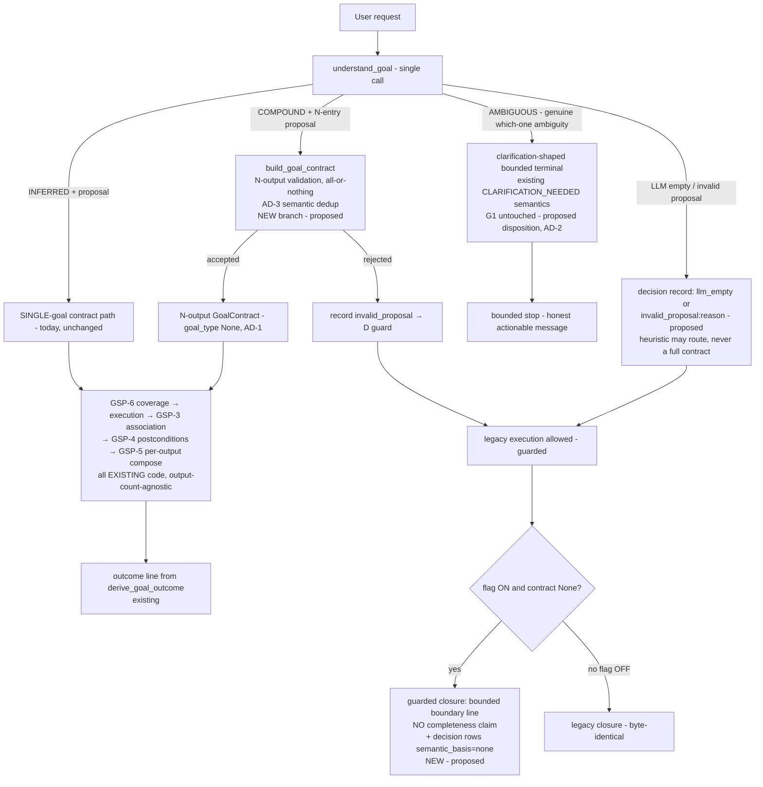

# Compound Goal Extraction & Contract-less Safety — Design Review v1

**Status: Draft for PMO Review — Design Only, Not Approved for Implementation**

**Date**: 2026-10-09
**Revision 2**: 2026-10-09 — PMO design-review feedback incorporated.
AD-2 reworked: `COMPOUND` (clear multi-goal), genuine `AMBIGUOUS`
(clarification / bounded-termination first; never silently executed as
one goal), and `LLM_EMPTY` / `INVALID_PROPOSAL` are now three explicitly
distinguishable dispositions (§10–§12, §18-AD-2). AD-1 direction fixed
with compatibility evidence: top-level `goal_type=None` for heterogeneous
contracts (§6, §10-E2, §14, §18-AD-1). AD-3 tightened: dedup only on
full canonical semantic equivalence — never on textual similarity
(§10-E2, §16, §18-AD-3). AD-6 tightened: the contract-less guard does
not depend on LLM prose or the `semantic_basis` label alone; Activity
reasons AND the final response are bound; execution terminal status is
never semantic COMPLETE evidence (§7-INV-8/INV-7, §12). No direction
change: Option E (A + D) remains the recommendation; GSP-4/5/6/7, G1,
and O2 boundaries untouched.

**Basis**: verified working-tree code (HEAD `58881a9` + GSP working
tree), Exploratory Session 01 evidence, and the GSP design/implementation
plans. Every As-Is statement below was read from the current source or
reproduced from recorded runs; design proposals are clearly marked.
This document changes nothing until approved.

---

## 1. Executive Summary

GSP-1…GSP-7 give the runtime a per-output semantic governance chain —
**but only when a GoalContract exists**. Exploratory Session 01 showed a
stable, wording-independent gap *upstream* of that chain: compound user
requests ("有没有对冲交易？另外把关联账号也列出来。") are classified
`AMBIGUOUS` by goal understanding, the required-outputs proposal is then
**dropped by code**, no contract is built, and the run degrades to the
legacy path — which answers whichever single skill the planner chose and
leaves the other requested deliverable **silently absent** while the run
terminates `completed` / `goal_satisfied`.

The audit locates the defect precisely:

1. The goal-understanding **prompt already asks** for "one entry per
   DISTINCT requested answer (multi-part requests get multiple entries)"
   — the model is *supposed* to propose N outputs for compound requests
   and, in the recorded probe, even *names both objectives* in its
   reason text.
2. The **acceptance code contradicts the prompt**: `understand_goal`
   attaches `contract_proposal` only on the `INFERRED` branch (single
   goal_type); the `AMBIGUOUS` branch returns without it
   (`goal_resolution.py:629-644`). The model has no way to be honest
   about two goals *and* have them preserved.
3. Downstream of an accepted contract, the entire chain is already
   output-count-agnostic (multi-output contracts are accepted today;
   GSP-6 coverage, GSP-3 association, GSP-4 evaluation, GSP-5 rendering
   and GSP-7 preservation all iterate `contract.outputs`). **No
   downstream change is needed to govern compound goals.**
4. Contract-less runs have **no completeness governance at all**: no
   coverage, no satisfaction, no GoalOutcome, legacy composer renders
   one skill's payload plus "The investigation completed.", decision
   reasons are unverified prose (one recorded overclaim), and the
   AMBIGUOUS state is invisible to the user.

**Recommended architecture (Option E = A + D):**

- **A — Compound resolution in the existing single call**: add a
  deterministic `COMPOUND` goal-resolution outcome that carries a
  validated multi-output proposal. The prompt's contradictory rules are
  reconciled (compound multi-part → `COMPOUND` + N entries; `AMBIGUOUS`
  narrows to genuine which-one ambiguity and is met with a
  clarification-shaped bounded stop, not silent single-goal execution —
  AD-2). All existing per-output validation (`build_goal_contract`) is
  reused unchanged; heterogeneous contracts take `goal_type=None`
  (AD-1).
- **D — Contract-less safety net** (independent of A, flag-gated):
  when the flag is ON and no contract exists, the legacy composer must
  not present a bare completion — it appends a deterministic bounded
  boundary (no completeness claim, no invented goal list), decision
  rows carry an explicit system-computed `semantic_basis` marker so
  prose reasons can no longer act as completion evidence, and an
  additive `goal_contract_decision` record distinguishes
  LLM-empty / invalid-proposal / ambiguity provenance (D-3/D-4).

No new database, no MCP, no new tools/evidence types, no requirement
DSL, no changes to GSP-4/5/6/7 semantics, G1, O2, or the flag default.
Single-goal behavior is byte-identical when the flag is OFF and
semantically identical (plus a normal contract) when ON.

---

## 2. Scope / Non-goals

**In scope**: goal-understanding representation and proposal protocol
for compound intent; contract acceptance rules for multi-output
proposals; safety behavior of contract-less runs under the GSP flag;
decision-language/completion-claim integrity; integration boundary with
the existing GSP chain; compatibility, flags, and the future test
matrix.

**Non-goals (this design neither does nor proposes)**:

- Any production code change in this phase (design only).
- Changing GSP-4 assessment adjudication (`UNRESOLVED` /
  `judgment_not_adjudicable`), GSP-5 `GoalOutcome` derivation rules,
  GSP-6 coverage rules, GSP-7 contract-preservation, or O2 ANY-contract
  semantics.
- ALL / requirement groups / a new evidence-requirements DSL.
- G1 target-validity changes; finding lexicons; nearest-capability
  fallback; new tools, MCP, capability registries, or a second state
  store.
- Solving extraction *completeness* in general (the documented §1
  boundary stands: an accepted contract is complete **for the goals it
  represents**, never provably complete for the request).
- UI redesign (any frontend consumption remains additive and deferred).

---

## 3. Evidence Baseline from Exploratory Session 01

Sources: `docs/qa/2026-10-09-gsp-exploratory-session-01.md`,
`docs/evaluations/gsp-exploratory-s01-trials-20261009T024343Z.json`,
the 2026-10-08 browser acceptance record
(`docs/qa/2026-10-08-gsp7-replan-api-e2e-v1.md`), and the live store
documents of each recorded run.

Verified facts (real browser, real model, no fixture):

| # | Fact | Evidence |
|---|---|---|
| F1 | 5/5 compound variants (original, order-swapped, explicitly enumerated, compound-verb, repeat) → goal understanding `AMBIGUOUS` (source=llm), `GoalContract=None`, legacy path | Store documents of TASK runs in the archive JSON; `goal_representation.goal_resolution="AMBIGUOUS"` |
| F2 | The model **names both objectives** in the AMBIGUOUS reason ("The request combines two distinct objectives: checking whether the account has hedging trades and listing its related accounts.") | A-rerun store doc TASK-0edf9e6af03e; offline probe |
| F3 | Every compound run planned exactly ONE skill: A/B/rerun `[analyze_related_accounts]`; C/D `[analyze_cross_account_trades(, generate_artifact)]` | `plan_steps` in store docs |
| F4 | The composed answer contained exactly one subgoal; the other appeared nowhere (C: the string 关联账号 is absent from the entire response) | `task_response_text` per trial |
| F5 | In 4/5 runs the decision proposer DETECTED the missing subgoal at RE_PLAN ("对冲交易的分析尚未进行…" / "关联账号清单尚未产出…") but the re-plan repeated the same skill; convergence guard stopped the loop | `decisions[]` in store docs |
| F6 | C's final STOP reason claimed both enumerated items answerable while the second was never investigated | Store `decisions[]`, Activity-rendered |
| F7 | Single-goal controls were healthy: E1 contract GC-20f926ff → PARTIAL rendered honestly; E2 GC-6d98eb26 → satisfied/complete | Store docs + responses |
| F8 | Second contract-less mechanism: LLM empty response → deterministic heuristic classifies a compound request as ONE goal (`cross_account_check`, source=heuristic) — no proposal ever exists | Session-01 probe log |
| F9 | Contract-less observations are explicitly marked: `for_outputs: []`, `association_reason: "no_contract"`; `planning_coverage=[]`, `step_output_map={}` | TASK-0edf9e6af03e document |
| F10 | G1/target admission never consulted the goal resolution; all compound runs passed target admission and executed | `target_validity.py` (no goal_resolution import); recorded runs executed |

Not claimed (per §1.2 of the work package): GSP-4/5/6 have no newly
proven defect — with no contract they never ran; they are neither
"passed" nor "failed" for these turns. The O2 ANY-contract boundary is
unrelated (no contract existed to which it would apply).

---

## 4. As-Is Architecture and Failure Sequence

### 4.1 The goal pipeline (verified code paths)

```
User request (raw text)
  │
  ├─► understand_goal()                       goal_resolution.py:563
  │     ├─ _build_goal_prompt()               :469  ← schema contradiction lives here
  │     ├─ LLM call (single)                  :605
  │     ├─ payload parse                       :610
  │     ├─ proposal extraction (flag-gated)    :621-625   proposal := required_outputs
  │     ├─ AMBIGUOUS branch                    :629-636   ← proposal DISCARDED  ★ defect site
  │     ├─ INFERRED branch                     :637-644   ← proposal attached ONLY here
  │     └─ exception/empty → heuristic_goal()  :653-656   ← never a proposal      ★ 2nd mechanism
  │
  ├─► GoalRepresentation                       :192-234  single goal_type; AMBIGUOUS needs ≥2 vocab types
  │
  ├─► build_goal_contract(repr, case_id)       :285-370  all-or-nothing per-output validation
  │     └─ accepts N outputs TODAY (goal_type is str|None; ids unique)
  │
  └─► AgentLoopState.goal_contract             agent_loop.py:1036-1038
        reject ⇒ None ⇒ entire GSP chain skipped
```

### 4.2 What a contract-less run actually does (verified)

```
goal_contract = None
  ├─ GSP-6 coverage admission: SKIPPED (flag AND contract gate, :1428/:1699)
  │    planning_coverage = [] , step_output_map = {}            (F9)
  ├─ GSP-3 association: runs, but marks for_outputs=[] + "no_contract" (F9)
  ├─ GSP-4 postconditions: never invoked (association+contract gate, :1559)
  │    satisfaction never computed
  ├─ GSP-5 composer: NOT selected (:2663 requires contract)
  │    legacy: payload branches + "The investigation completed." (:2097)
  │    + last-3 observation lines — no unanswered-goal note
  ├─ derive_goal_outcome(): never runs → goal_outcome = None
  ├─ completion: criteria_satisfied() = ANY-success (:585-606, baseline)
  │    → STOP accepted → AgentStatus.COMPLETED / StopReason.GOAL_SATISFIED
  ├─ decision proposer: LLM sees goal TEXT + steps + last observation
  │    only (:689-701); reasons are free prose ≤300 chars, mirrored to
  │    Activity verbatim — no structured gate          (F5, F6)
  └─ _re_plan digest: completed steps + last-2 observations + last
       decision + (flag ON) unsupported STEP TYPES — no structured goal
       set; the missing-subgoal knowledge exists only in prose  (F5)
```

### 4.3 As-Is failure sequence (Mermaid — verified facts only)

```mermaid
sequenceDiagram
    participant U as User request
    participant G as understand_goal
    participant C as build_goal_contract
    participant L as Agent Loop
    participant P as PlannerV2 (one skill/plan)
    participant K as Composer (legacy branch)

    U->>G: "有没有对冲交易？另外把关联账号也列出来"
    G->>G: prompt: "one entry per DISTINCT requested answer"<br/>but also "AMBIGUOUS when 2+ objectives"
    G->>G: model returns AMBIGUOUS (+ proposal, unused)
    Note over G: AMBIGUOUS branch DROPS proposal ★
    G->>C: representation without proposal
    C-->>L: (None, "no_proposal") ⇒ goal_contract = None
    Note over L: GSP-6 coverage: skipped (no contract)<br/>GSP-3: for_outputs=[] "no_contract"<br/>GSP-4/GSP-5: never run
    L->>P: plan → ONE skill (e.g. analyze_related_accounts)
    P-->>L: single-skill plan; subgoal B has no step
    L->>L: proposer detects missing subgoal (prose) → RE_PLAN
    L->>P: re-plan → SAME skill again
    L->>L: identical result → convergence STOP
    Note over L: criteria_satisfied = ANY-success ⇒ COMPLETED / GOAL_SATISFIED
    L->>K: compose (legacy branch — no contract)
    K-->>U: subgoal A answered; subgoal B absent; "The investigation completed."
    Note over K: AMBIGUOUS invisible; no completeness governance ★
```

### 4.4 The prompt/acceptance contradiction (the precise root cause)

`_build_goal_prompt` (goal_resolution.py:477-519) simultaneously says:

- Base schema: *"INFERRED when the request clearly expresses one
  objective. AMBIGUOUS when two or more materially different objectives
  are equally plausible."*
- GSP block: *"one entry per DISTINCT requested answer (multi-part
  requests get multiple entries, in request order)"*

For a compound request these two instructions conflict. The recorded
model behavior (5/5) is to obey the base rule (`AMBIGUOUS`) — and the
acceptance code then discards whatever `required_outputs` the model
nevertheless returned (AMBIGUOUS branch returns without the proposal,
:629-636). The system's own protocol prevents the model from telling
the truth in a form the system keeps.

---

## 5. Root Cause Analysis

**Primary cause (structural, not model capability):** the goal
representation protocol has no compound outcome. `INFERRED` requires
exactly one goal_type; `AMBIGUOUS` semantically means "which ONE of
these did you mean" and drops the proposal by code. A request with two
independently answerable deliverables is therefore forced into a state
that cannot carry them.

**Secondary causes (safety gaps that exist regardless of #1):**

- **RC-2 — Contract-less runs have no completeness governance.** No
  coverage, no satisfaction, no GoalOutcome; the legacy closure asserts
  completion unconditionally for COMPLETED status; decision reasons are
  unverified prose that reaches the user (F6).
- **RC-3 — The planner is one-skill-per-plan**, and the re-plan loop
  cannot act on the proposer's (correct) detection of a missing
  cross-skill subgoal; the convergence guard then bounds a loop that
  could never have succeeded. (Not a defect to "fix" by multi-skill
  plans in this design — governed by the contract path instead.)
- **RC-4 — Heuristic fallback always yields a single goal** with no
  proposal (mechanism 2), indistinguishable at composition time from a
  genuinely single-goal request except via `source="heuristic"`.

Explicitly rejected root-cause framings: "the model is not smart
enough" (it identified both goals and asked for multiple entries — F2,
prompt text), "the planner is not smart enough" (single-skill plans are
the designed contract; the missing piece is upstream representation).

---

## 6. GoalRepresentation / GoalContract / RequiredOutput Responsibilities

| Artifact | Owns | Must NOT own |
|---|---|---|
| `GoalRepresentation` | what the LLM proposed, raw: resolution status, (single) goal_type, ambiguous candidates, user-safe reason, `contract_proposal` dict | acceptance; satisfaction; capability awareness |
| `build_goal_contract` | deterministic acceptance: per-output field validation (claim/claim_kind/subject/scope/evidence vocabulary, subject-consistency with the accepted resolution), system-assigned `O1..On`, all-or-nothing accept/reject, rejection reason | repair, substitution, partial acceptance, capability judgment |
| `GoalContract` | the accepted semantic promise: N outputs, immutable content, per-output mutable `satisfaction` (GSP-4 only), `contract_id` | re-interpretation on RE_PLAN; execution state |
| `RequiredOutput` | one independently answerable user deliverable; claim ≠ evidence type (orthogonality enforced); evidence_requirements = ANY-set of categories | steps, tools, other outputs' evidence |

Single-goal sufficiency: one output expresses one deliverable; multiple
evidence categories for ONE question stay inside `evidence_requirements`
(ANY-set) — output decomposition and evidence-category union are
orthogonal and must not be conflated (O2 untouched).

---

## 7. Design Invariants

Numbered for reference; each lists scope, enforcer, violation behavior,
and the future test that pins it. "Flag ON" =
`ENABLE_GOAL_SEMANTIC_CONTRACT=true`.

| # | Invariant | Scope | Enforcer | On violation | Future test |
|---|---|---|---|---|---|
| INV-1 | Every system-accepted user deliverable has a structured RequiredOutput **or** the run is explicitly marked ungoverned (contract-less) and never claims full-request completeness | extraction→composer | `build_goal_contract` + composer guard (D) | guard boundary line replaces bare completion | L1 + Browser E2E compound-with-contract |
| INV-2 | The system must not silently compress a compound request into one goal and declare the whole request answered | goal layer + composer | COMPOUND protocol (A) + D guard | compound → contract with N outputs; else guarded boundary | L1 extraction table; Browser E2E trials A–D shapes |
| INV-3 | Without a contract, no path may claim full-request completion (flag ON) | composer + decision recording | D-1 closure guard, D-2 `semantic_basis` marker | bare completion line replaced; decision rows marked ungoverned | L1 composer table; API E2E |
| INV-4 | An accepted contract is never narrowed by RE_PLAN or tool failure | loop | GSP-7 (existing, unchanged) | bounded REPLAN_FAILURE etc. | existing gsp7 suite (kept green) |
| INV-5 | Evidence acquisition success ≠ output satisfaction | postconditions | GSP-4 (existing) | — | existing gsp4 suite |
| INV-6 | One satisfied output ≠ all outputs satisfied | outcome derivation | `derive_goal_outcome` (existing) | PARTIAL | existing gsp4/5 tests + new multi-output case |
| INV-7 | `COMPLETED`/`GOAL_SATISFIED` never imply semantic COMPLETE | composition boundary | GSP-5 outcome line (contract) / D guard (no contract) | outcome line states the real outcome | Browser E2E (D-journey shape, kept) |
| INV-8 | Completeness language in user-facing surfaces is system-derived only: gated by deterministic state (accepted contract + derived outcome, or guarded boundary with NO completeness claim). Safety does NOT rest on LLM prose, nor on the `semantic_basis` label alone — the label marks audit state, the composer guard and the outcome line are the enforcement | composer + decision recording | D-1 closure guard (text), D-2 marker (audit), GSP-5 outcome line (unchanged) | prose claims never authoritative; the guard does not parse prose | L1 + API E2E assertion on response text |
| INV-9 | Single-goal behavior preserved (flag OFF byte-identical; flag ON adds only the normal contract) | all | flags + regression matrix | — | existing suites + flag-OFF identity tests |
| INV-10 | "No usable extraction proposal" ≠ "genuine goal ambiguity" ≠ "model unavailable" — three distinguishable, recorded states (COMPOUND accepted / `goal_contract_decision` outcome ∈ {no_proposal, invalid_proposal:<reason>, llm_empty→heuristic-routed} / AMBIGUOUS) | goal layer | `goal_contract_decision` record (§10-E3) | — | L1 extraction table (trichotomy) |
| INV-11 | Extraction failure is never mapped to capability `UNSUPPORTED` | layer separation | by construction (UNSUPPORTED is planning-time, contract-gated) | — | L1 negative test |
| INV-12 | Output identity is stable and verifiable (system-assigned ids in proposal order); dedup ONLY on full canonical semantic equivalence (claim+claim_kind, subject_ref, scope, normalized evidence_requirements) — textual similarity is never equivalence | acceptance | `build_goal_contract` dedup rule (AD-3) | non-equivalent outputs are never collapsed; equivalence collapses are deterministic | L1 dedup matrix (equivalence + non-equivalence cases) |
| INV-13 | Genuine goal ambiguity is never silently resolved into the conveniently-classifiable single goal and executed as the complete request: the disposition is clarification-shaped bounded termination (existing `CLARIFICATION_NEEDED` semantics, G1 untouched) | goal checkpoint in the loop | AMBIGUOUS disposition (§10-E3, AD-2) | bounded stop with an honest, actionable message; no fabricated single-goal contract | L1 AMBIGUOUS-disposition table; Browser E2E genuine-ambiguity journey |
| INV-14 | Model-unavailable provenance is recorded and can never back a completeness claim: an LLM-empty run routed through the heuristic is marked (`goal_contract_decision` outcome + `source="heuristic"`) and is contract-less | goal layer + guard | decision record + D guard | guarded boundary; no completeness language | L1 provenance tests; API E2E empty-response case |

---

## 8. Options Analysis

### Option A — Multi-output proposal inside the existing GoalRepresentation

Add a deterministic resolution outcome `COMPOUND` (new
`GoalResolutionStatus` value): "the request contains ≥2 independently
answerable deliverables, all represented in the accompanying
required_outputs proposal." The prompt's base rules are reconciled:
compound multi-part requests → `COMPOUND` + N entries (the GSP block's
existing "one entry per DISTINCT requested answer" wording is kept — it
already says this); `AMBIGUOUS` reverts to its intended, narrower
meaning — genuine uncertainty WHICH single objective the user means
(user goal, required subject, or other load-bearing semantics cannot be
determined) — and is handled by clarification-shaped bounded
termination, NOT by silently executing whichever goal happens to
classify easily (AD-2; §10-E3).

- Same single LLM call (no new semantic call — §3.4 respected).
- Acceptance = existing `build_goal_contract` per-output validation,
  unchanged, plus: COMPOUND requires ≥2 valid outputs and rejects the
  whole proposal otherwise (all-or-nothing preserved). Optionally each
  output MAY echo a goal_type as a routing hint (informational only —
  admission is evidence-based, so it is not load-bearing; avoids
  inventing vocabulary).
- `GoalContract.goal_type` is already `str | None` — a compound
  contract can be represented today (AD-1: keep `None` vs a
  `"compound"` label).
- Single-goal compatibility: `INFERRED` + proposal behaves exactly as
  today (1-output contract). Flag OFF: the new status never emitted;
  behavior byte-identical.
- Failure containment: invalid COMPOUND proposal → whole rejection →
  the D guard (not silent single-goal execution with a completion
  claim).

Strengths: minimal surface; fixes the root; downstream is already
N-output-ready (verified); no new state store. Weaknesses: depends on
the model choosing COMPOUND correctly (mitigated by prompt
reconciliation + D); over-split risk (two outputs for one question —
mitigated by AD-3 dedup rule; consequence is granularity, not a
completeness lie).

### Option B — A separate goal-list extraction protocol / second call

A dedicated "goal list" structure or a second LLM pass that first
enumerates goals, then proposes outputs per goal.

Rejected. The single call already carries the full proposal schema; a
second call adds latency, a new failure mode (empty/refused responses —
already observed), and a second representation to keep consistent with
`GoalRepresentation` — all to carry data the first call can already
carry. No evidence in the sessions suggests the model cannot enumerate
outputs in one pass (the probe shows it naming both objectives in one
response). Cost without benefit; violates §3.4's call-budget discipline.

### Option C — Partial contract (accept valid outputs, mark the rest unresolved)

Accept the valid subset of a partially invalid proposal; represent
unextracted goals as "unresolved".

Rejected as the primary mechanism. (a) **Unknown-goals problem**: if the
model only extracted one of two goals, the system has no object to mark
"the missing one" — partial acceptance cannot represent what was never
proposed; it only helps for *validation*-invalid outputs. (b) **Silent
narrowing at the contract layer**: accepting the valid subset of an
invalid proposal re-creates the exact silent-drop being fixed, one layer
earlier, with a contract's seal of approval on top. (c) It complicates
the acceptance semantics ("is this contract complete?") for a case the
all-or-nothing rule already handles safely (reject → D guard). The
all-or-nothing rule stays.

### Option D — Contract-less safety degradation (independent of extraction)

Three sub-mechanisms; all flag-gated (ON only), all deterministic, none
trusting LLM prose:

- **D-1 Completion-claim guard (composer)**: flag ON + contract None +
  `COMPLETED` status → the legacy closure's bare status phrase is
  augmented/replaced by a bounded boundary, e.g.:
  「本次调查未能建立完整的目标分解：以下结果可能未覆盖您请求的全部
  内容；如需其余部分，请分别提出或换一种表述。」
  No enumeration of "missing" items (the system cannot know them — that
  would be fabrication). Wording is deterministic; flag OFF → the exact
  legacy text (byte-compatible).
- **D-2 Decision-row semantic marking**: contract-less decision records
  gain an additive system field (`semantic_basis: "none"`, projected
  additively) so any prose "both answered" claim is structurally
  denoted as ungoverned. Prose is NOT rewritten (auditability kept);
  the marker makes INV-8 checkable.
- **D-3 AMBIGUOUS disposition (genuine ambiguity)**: under flag ON,
  genuine `AMBIGUOUS` (the model explicitly reports ≥2 plausible
  single-objective readings — user goal or load-bearing semantics
  undeterminable) is **not** executed as one conveniently-classifiable
  goal. The disposition reuses the loop's existing
  clarification-shaped bounded terminal (`agent_status=blocked`,
  `stop_reason=clarification_needed` semantics — the same shape the G1
  target-clarify path already renders) with an honest, actionable
  message; G1 itself is untouched and its decisions always win. The
  served `goal_representation` already carries `AMBIGUOUS` additively.
  (AD-2; replaces the former "proceed + guard" disposition.)
- **D-4 Extraction-decision record**: the loop records an additive
  `goal_contract_decision` {outcome: `contract_accepted` |
  `no_proposal` | `invalid_proposal:<reason>` | `llm_empty` |
  `heuristic_single_goal`, reason} so LLM-empty, invalid-proposal,
  genuine-ambiguity and heuristic-routed runs are machine-
  distinguishable (INV-10/INV-14) and the D-1 guard keys on this
  deterministic record — not on prose.

Strengths: closes the RC-2 hole for EVERY contract-less cause (LLM
empty, invalid proposal, genuine ambiguity, heuristic single-goal
misread) without solving extraction; tiny surface; independent rollback;
the trichotomy (D-3/D-4) removes the recorded failure shape where a
compound request was half-executed and presented as complete.
Weaknesses: does not make compound requests *answerable* (only honest);
the boundary names no missing items; genuine-ambiguity runs now stop
before planning instead of half-answering — a deliberate honesty
trade-off (§17).

### Option E — Combination A + D (recommended)

A removes the structural blocker for well-formed compound requests; D
bounds the residual risk for everything that still fails (model empty,
invalid proposals, true ambiguity, heuristic misclassification). They
are complementary, not alternative: A without D leaves the silent-drop
hole open for extraction failures; D without A leaves compound requests
permanently unanswerable-as-asked. Both live behind the existing
`ENABLE_GOAL_SEMANTIC_CONTRACT` flag (AD-4: reuse vs new flag).

### Comparison

| Criterion | A (COMPOUND) | B (2nd protocol) | C (partial contract) | D (safety net) | E = A+D |
|---|---|---|---|---|---|
| Silent-drop safety | partial (only when extraction succeeds) | partial | weak (new narrowing risk) | strong (all contract-less causes) | strong |
| Extraction completeness for compound | yes (represented goals) | yes | no | no | yes (represented) + honest residual |
| Single-goal compatibility | byte-identical OFF; identical ON | new call in path | acceptance-semantics change | flag OFF untouched; ON adds boundary line only | same as A+D |
| Extra model dependency | none (same call) | +1 call | none | none | none |
| State complexity | +1 enum value, validator branch | new object + sync | new partial states | +1 additive marker field | moderate, additive |
| Backward compatibility | high (additive; old states load) | medium | low-medium | high | high |
| Test difficulty | extraction table + paraphrase matrix | protocol tests | acceptance-matrix expansion | composer/decision tables | largest but bounded |
| Main risk | model misroutes COMPOUND/AMBIGUOUS (prompt + tests mitigate) | latency/empty-response exposure | silent narrowing with contract seal | boundary fatigue if over-shown | combined (each mitigated) |
| Implementation cost | low-medium | medium-high | medium | low | medium |

---

## 9. Recommended Architecture

**Option E (A + D), behind `ENABLE_GOAL_SEMANTIC_CONTRACT`** (reuse;
see AD-4).

To-Be flow (proposed; distinct from §4.3 facts):



Key point: **nothing downstream changes**. GSP-6 admits per output;
GSP-3 associates per output; GSP-4 evaluates per output; GSP-5 renders
per output and derives the overall outcome from N satisfactions; GSP-7
preserves the N-output contract across RE_PLANs. All of this is
verified in the current code and tests (multi-output contract accepted
in `test_gsp2_*::test_case_d`; composer iterates `contract.outputs`).

---

## 10. Goal Extraction and Contract Acceptance Protocol (proposed)

**E1. When is a deliverable a separate RequiredOutput?**

A `RequiredOutput` is proposed per **independently answerable
deliverable** — something the user would accept as a discrete, separate
answer. NOT a separate output: an execution step, a constraint on one
question ("30秒内"), an evidence category for one question (those live
in `evidence_requirements` — the ANY-set is unchanged; O2 untouched),
or a sub-clause of the same judgment. The semantic basis is the
proposal schema already in the prompt ("the DISTINCT answers the user
asked the system to produce"); the design changes only WHEN the system
keeps the answer (COMPOUND instead of drop-on-AMBIGUOUS).

Over-split risk: the model may split one question into two outputs.
Consequences: both outputs get answered/rendered — granularity noise,
never a completeness lie; AD-3 defines the deterministic dedup rule
(exact duplicates by (claim, subject_ref, scope) collapse; near
duplicates kept and rendered). Under-split (the current failure) is
strictly worse and is what this design removes for representable
compound requests.

**E2. Contract acceptance conditions** (all deterministic):

1. Proposal present and non-empty (existing).
2. Every output passes the existing per-output validation (claim
   non-empty & not an evidence type; claim_kind ∈ enum; subject
   non-empty and consistent with the accepted resolution or case;
   scope ∈ enum; evidence requirements ⊆ frozen vocabulary) —
   existing rules, unchanged.
3. `COMPOUND` additionally requires ≥2 outputs (a 1-output COMPOUND is
   rejected as malformed → D guard path).
4. All-or-nothing: any invalid output rejects the whole proposal
   (existing; C rejected for the reasons in §8).
5. Identity: output_ids remain system-assigned `O1..On` in proposal
   order (existing).
6. **Top-level goal_type (AD-1 direction)**: a heterogeneous contract
   (outputs spanning different deliverable kinds) takes
   **`goal_type=None`** — the system does not fabricate a single
   business goal_type and claim it represents the whole contract.
   Compatibility verified in the As-Is audit: the `GoalContract`
   schema already declares `goal_type: str | None = None` with no
   vocabulary constraint at contract level (goal_resolution.py:174);
   no runtime code consumes `goal_contract.goal_type` (the planner
   prompt block, association, postconditions and composer all read
   `outputs`); whole-model JSON persistence serializes None without
   migration; historical contracts (always non-None) load unchanged;
   the activity projection dumps the model additively. Each
   RequiredOutput's own claim / claim_kind / subject_ref / scope /
   evidence_requirements remains the authoritative per-item semantics.
7. **Semantic dedup (AD-3)**: only RequiredOutputs whose **canonical
   semantic content is fully equivalent** may collapse to one output:
   equal claim (normalized text), equal claim_kind, equal subject_ref,
   equal scope, and equal **normalized evidence_requirements** (the
   ANY-set normalized to a set — order-insensitive by existing
   semantics). Textual similarity of claims is NOT equivalence.
   Outputs differing in subject_ref, scope, claim_kind, or
   substantively in evidence requirements are NEVER collapsed.
   Equivalence collapses are deterministic and recorded; anything not
   provably equivalent stays a separate output (over-representation is
   safe — it renders as its own answered/bounded item; under-
   representation is the failure this design removes).

Three distinct levels, never conflated (existing vocabulary suffices):
**expressed** (in the accepted contract) → **executable** (GSP-6
coverage verdict; uncovered ⇒ `UNSUPPORTED` mark + boundary render) →
**satisfied** (GSP-4 verdicts). Extraction failure never becomes
`UNSUPPORTED` (INV-11) — UNSUPPORTED is only ever a planning-time
verdict about a *represented* requirement.

**E3. Extraction outcomes are explicitly distinguished** (per §5.3 and
the AD-2 revision). The loop records an additive
`goal_contract_decision` {outcome, reason} at the goal checkpoint so
every contract-less cause is machine-separable:

| Situation | Resolution state | `goal_contract_decision.outcome` | Disposition (flag ON) |
|---|---|---|---|
| Clear compound request, valid N-entry proposal | **COMPOUND** | `contract_accepted` (N outputs) | full GSP path over N outputs |
| Compound/garbage proposal that fails validation | COMPOUND or INFERRED | `invalid_proposal:<reason>` (existing `build_goal_contract` reasons: `invalid_evidence_type`, `subject_mismatch`, …) | legacy execution + D guard; never a fabricated contract |
| **Genuine semantic ambiguity** (goal/subject/load-bearing semantics undeterminable; model reports ≥2 plausible single-objective readings) | **AMBIGUOUS** | `ambiguous_not_executed` | **clarification-shaped bounded termination** (existing `CLARIFICATION_NEEDED` semantics): honest, actionable message; G1 untouched; the easily-classifiable goal is NOT picked as the whole request |
| LLM empty/error response | heuristic single-goal (source=heuristic) | `llm_empty` | heuristic may still drive **constrained routing** as today, but the run is contract-less: legacy execution + D guard; the single-goal outcome can never be presented as the complete user request |
| No objective determinable | UNRESOLVED | `no_proposal` | today's bounded behavior + D guard |

Rules fixed by this table: (i) `AMBIGUOUS` no longer reaches the
planner at all under flag ON (today it silently proceeds — the recorded
F1 failure shape); (ii) `LLM_EMPTY` is recorded as provenance
(INV-14) — the heuristic classification is a routing convenience, never
evidence that the user's whole request was understood; (iii)
`INVALID_PROPOSAL` reasons are the existing deterministic
`build_goal_contract` codes, now surfaced on state instead of only on
the Noop telemetry sink; (iv) no path may infer whole-request
completion from single-goal execution success.

**E4. Execute without a contract?** Yes — unchanged execution
behavior, changed *completion claims* (per §5.4) — with one addition
from the AD-2 revision: **genuine AMBIGUOUS does not execute at all**
(clarification-shaped bounded termination, E3).

- What runs (non-AMBIGUOUS contract-less causes): exactly today's
  legacy path (planning bound by the same registry checks; any single
  skill may be pursued).
- How far: to the same bounded terminals (including convergence/limit
  stops).
- Missing goals: cannot be enumerated (nothing represents them); the
  D-1 boundary states their existence class, not a fabricated list.
- Who decides completion: the loop's existing deterministic policy
  decides the loop terminal; **semantic completion claims are owned by
  the composer**: contract runs → GSP-5's outcome line (system-derived);
  contract-less runs (flag ON) → the guarded boundary line carries NO
  completeness claim. Flag OFF → legacy text byte-for-byte.
- Over-trigger analysis: with A live, contract-less runs are exactly
  the extraction-failure residue — rare by construction; the
  boundary cannot misfire on healthy single-goal runs (they produce a
  contract). Genuine-ambiguity runs stop before planning instead of
  half-answering — a deliberate honesty trade-off recorded in §17.

**E5. Decision-language authority** (per §5.5):

- LLM proposer prose (`decision.made` reasons): advisory only; never a
  completeness proof. D-2 marks contract-less rows
  (`semantic_basis: "none"`).
- System-computed coverage (`planning_coverage`), satisfaction
  (`RequiredOutput.satisfaction`), outcome (`GoalOutcome`): the only
  permitted bases for completeness statements.
- User-facing final response: completeness language originates ONLY
  from `_compose_gsp_response`'s outcome line (existing) — or, under
  flag ON + no contract, from the guarded boundary line which contains
  none. No third source. The composer is the single write-site for
  completion language (same single-write-site discipline as GSP-4).

---

## 11. Contract-less / Ambiguous / Invalid-proposal Safety Policy (proposed)

Policy table (flag ON; normative summary of §10-E3 — the two tables
must stay in sync during implementation):

| Situation | Resolution state | `goal_contract_decision` | Contract | Behavior |
|---|---|---|---|---|
| Healthy single goal | INFERRED + 1-output proposal | `contract_accepted` | accepted | today's GSP path, unchanged |
| Clear compound, well-formed | **COMPOUND** + N-entry proposal | `contract_accepted` (N) | accepted (N outputs) | today's GSP path over N outputs — coverage per output; uncovered → UNSUPPORTED boundary; PARTIAL/UNANSWERABLE per GSP-5 |
| Proposal fails validation | COMPOUND/INFERRED | `invalid_proposal:<reason>` | None | legacy execution + D-1/D-2 guards |
| **Genuine semantic ambiguity** | **AMBIGUOUS** | `ambiguous_not_executed` | None | **clarification-shaped bounded termination** (existing `CLARIFICATION_NEEDED` semantics; G1 untouched) — never executed as the easily-classifiable single goal |
| LLM empty/error → heuristic routed | INFERRED (source=heuristic) | `llm_empty` | None | constrained legacy execution + D guards; heuristic routing never implies whole-request comprehension |
| No objective determinable | UNRESOLVED | `no_proposal` | None | today's bounded behavior + D guards |

Cross-cutting constraints (AD-6, normative):

1. **No completeness claim without a complete contract.** In every
   contract-less row, neither the final response nor any
   user-visible surface may state or imply that all user goals were
   answered.
2. **Partial results may be shown, coverage-unconfirmed stated.** The
   existing partial answer content is not suppressed; the guarded
   boundary line states that full-request coverage could not be
   established.
3. **Safety is structural, not linguistic.** The guarantee rests on
   the composer's deterministic branch (contract present → outcome
   line from `derive_goal_outcome`; contract absent → boundary line
   with no completeness claim) — not on parsing LLM reasons, and not
   on the `semantic_basis` label alone (the label is audit state; the
   branch is the enforcement).
4. **Both surfaces are bound.** Activity decision rows and the final
   response answer are governed alike; `execution terminal status`
   (`COMPLETED`/`GOAL_SATISFIED`) is loop semantics and is never, by
   itself or combined with prose, evidence of semantic COMPLETE
   (INV-7/INV-8).

Distinctions preserved: model-understood-but-unrepresentable (fixed by
A), model-not-understanding (UNRESOLVED), model-silent (heuristic
route, provenance-recorded), validator-rejected (all-or-nothing +
recorded reason), genuinely-ambiguous (clarification-shaped stop) —
five states with distinct code paths and audit traces.

---

## 12. Decision-language / Activity Integrity

- `decision.made` rows keep proposer prose (audit value) and gain an
  additive `semantic_basis` field ("contract:<id>" | "none") computed
  by the loop at record time — projection additive only.
- The final response remains the single authoritative user surface for
  completion (E5). Activity summaries stay bounded prose; their
  governance status is machine-checkable via `semantic_basis`.
- Overclaim regression (Session-01 F6) becomes mechanically detectable:
  any completeness assertion in a `semantic_basis: "none"` row is a
  test failure (§16).
- **Authority boundaries (normative, per the AD-6 revision):**
  1. Completeness assertions are *produced* only by deterministic
     state — the GSP-5 outcome line (`derive_goal_outcome` over an
     accepted contract) — and *forbidden* everywhere else. The D-1
     guard branch produces no completeness language at all.
  2. The `semantic_basis` marker is audit/verification state; it does
     not by itself enforce anything. Enforcement lives in the
     composer's deterministic branch and in the guarded closure text.
     A test may therefore assert on response text, not on labels.
  3. LLM decision prose (reasons) is never a basis for completion.
     Under contract-less runs the loop marks rows ungoverned at record
     time; the UI-facing final response cannot inherit a completeness
     claim from them because the composer branch never emits one.
  4. `AgentStatus.COMPLETED` / `StopReason.GOAL_SATISFIED` are loop
     terminal semantics. Neither alone nor combined with proposer
     prose do they constitute semantic COMPLETE (INV-7); the only
     semantic-outcome writer remains `derive_goal_outcome` over an
     accepted contract.

---

## 13. Integration with GSP-1…GSP-7

| Component | Change | Rationale |
|---|---|---|
| G1 target-validity guard | **None** | target admission is orthogonal (F10); runs before/after goal understanding exactly as today |
| `GoalResolutionStatus` | +`COMPOUND` value; validator branch (flag-gated emission) | additive; old persisted values load unchanged |
| `GoalRepresentation` | validator accepts COMPOUND + proposal (≥2 outputs) | the only schema-adjacent change |
| `_build_goal_prompt` | base rules reconciled: compound multi-part → COMPOUND + N entries; AMBIGUOUS reserved for genuine which-one ambiguity | removes the contradiction (§4.4) |
| `build_goal_contract` | unchanged rules + COMPOUND ≥2 check + AD-3 canonical-semantic dedup | all-or-nothing kept |
| `GoalContract` / `RequiredOutput` | **no schema change** (goal_type already `str|None` — None used per AD-1 for heterogeneous contracts; outputs already N-ary) | verified; no consumer of contract.goal_type exists |
| Goal checkpoint (loop) | +additive `goal_contract_decision` record; +AMBIGUOUS disposition → clarification-shaped bounded terminal (flag ON; existing `CLARIFICATION_NEEDED` semantics; G1 untouched) | AD-2 trichotomy (§10-E3) |
| Planner | **none** — GSP-6 prompt block already lists N outputs | verified |
| GSP-6 coverage | **none** — per-output admission covers N outputs; uncovered → UNSUPPORTED (existing) | verified |
| GSP-3 association | **none** — step_output_map/for_outputs per output | verified |
| GSP-4 postconditions | **none** — per-output evaluation; ANY-set unchanged; assessment → UNRESOLVED unchanged | verified |
| GSP-5 composer | **none** in the contract branch; legacy branch gains the D-1 guard line (flag ON, no contract) | single write-site for completion language |
| GSP-7 RE_PLAN | **none** — contract preservation is output-count-agnostic | verified |
| Activity projection | additive `semantic_basis` on decision rows (and existing goal fields unchanged) | frontend consumes none today |
| Turn path | out of scope (documented deferral stands); D guard applies only to the loop composer | §13 of the implementation plan |

Extraction-failure ≠ capability-UNSUPPORTED is preserved by
construction (INV-11): UNSUPPORTED remains a planning-time verdict over
represented requirements only.

---

## 14. Backward Compatibility and Persistence

- **Persistence**: none needed — `AgentLoopState` (incl.
  goal_representation/goal_contract) is stored as whole-model JSON in
  TaskStoreV2; new enum values and additive decision-row fields appear
  in JSON without migration (same discipline as the GSP-2 contract
  field).
- **Old states**: a state persisted by current code loads under the new
  code (goal_resolution values INFERRED/EXPLICIT/AMBIGUOUS/UNRESOLVED
  all remain valid). Forward direction: a COMPOUND document read by OLD
  code passes the existing validator (the INFERRED/EXPLICIT-requires-
  goal_type check does not reject unknown statuses) — no crash, legacy
  treatment; acceptable one-way tolerance, documented.
- **Contract-less history**: old runs with contract=None read exactly
  as today (None → legacy projection); the D guard applies only to NEW
  runs (it is composer-side, not stored-response rewriting). The
  additive `goal_contract_decision` record and `semantic_basis` markers
  exist only on newly written states; old documents load without them
  (same tolerance rule as every prior additive field).
- **Flag OFF**: no COMPOUND emitted, no prompt change, no guard line —
  byte-identical legacy behavior (the existing OFF-identity test
  discipline extends to the new paths).
- **Read model / restart**: projection changes are additive keys;
  resume paths treat contract=None as legacy (existing rule).
- **No second state store**: the contract remains the single carrier.

---

## 15. Feature Flags and Rollout

- **Reuse `ENABLE_GOAL_SEMANTIC_CONTRACT`** for COMPOUND extraction and
  the D guard (AD-4). Rationale: one semantic switch already governs
  the contract chain; a second overlapping flag would double the
  test matrix (flag-interaction tests) for little rollback value — the
  guard and COMPOUND are one feature semantically ("governed goals").
  Rollback = flag OFF (existing discipline).
- Rollout order (future implementation, not this phase): L1 → flag ON
  API E2E on canonical stack → browser journeys → default remains OFF
  until acceptance, per the AL-3.5.1/GSP convention.

---

## 16. Test Strategy and Definition of Done (design-stage definition)

### L1 / Component (deterministic, scripted model boundary)

1. Extraction table (scripted LLM payloads): single-goal INFERRED+1
   output (backward compat); COMPOUND+2/3 outputs accepted with
   stable O1..On and `goal_type=None` (AD-1); COMPOUND with 1 output
   rejected; genuine AMBIGUOUS → `ambiguous_not_executed` + bounded
   clarification-shaped terminal (never planned); UNRESOLVED unchanged;
   invalid JSON / missing fields / **empty response** → heuristic route
   with `goal_contract_decision=llm_empty` recorded (INV-14); invalid
   evidence type / bad scope / subject mismatch → all-or-nothing
   rejection with `invalid_proposal:<reason>` recorded; flag OFF → no
   COMPOUND, no decision record, prompt byte-identical (existing
   single-call tests extended).
2. **Dedup matrix (AD-3)** — equivalence and non-equivalence cases:
   (a) collapse allowed: identical (claim-normalized, claim_kind,
   subject_ref, scope) AND set-equal evidence_requirements — including
   order-permuted requirement lists (ANY-set normalization);
   (b) collapse FORBIDDEN: same claim text but different subject_ref;
   different scope; different claim_kind; substantively different
   evidence requirement sets; near-synonym claim texts that are not
   byte-normalized-equal (textual similarity is never equivalence);
   (c) collapse is deterministic and recorded; the surviving output
   keeps `O1..On` identity stability.
3. Paraphrase matrix at the model boundary: enumerated / swapped-order
   / compound-verb forms produce COMPOUND+N via scripted payloads
   (real-model paraphrase robustness stays an E2E/exploratory concern).
4. Composer guard table: flag ON × {contract, no-contract} ×
   {COMPLETED, FAILED, BLOCKED} → exact closure text; contract-less
   COMPLETED closure contains NO completeness claim (INV-3/INV-8);
   flag OFF → byte-identical legacy text.
5. AMBIGUOUS disposition: flag ON + AMBIGUOUS → bounded
   clarification-shaped terminal with an honest actionable message;
   planner never runs; G1 decisions unaffected in all combinations.
6. Decision-row marking: semantic_basis presence/values; projection
   additive-only (existing whitelist test updated additively).
7. RE_PLAN preservation with N-output contracts (extends gsp7 patterns).
8. G1 non-interaction: COMPOUND and AMBIGUOUS runs with valid/invalid
   targets behave per existing guard rules (goal-layer dispositions
   never override G1).

### API E2E (real HTTP, deterministic seam for the model boundary)

1. Two-goal compound → contract with 2 outputs (goal_type None) → both
   covered → both answered (or honest per-output boundaries) → outcome
   PARTIAL or COMPLETE per satisfactions; `semantic_basis` populated.
2. Compound with malformed proposal → `invalid_proposal:<reason>`
   recorded → contract-less → guarded closure; no completeness claim in
   `task_response_text`.
3. LLM empty response → `llm_empty` recorded → heuristic-routed
   single-goal execution → boundary line present; heuristic outcome
   never rendered as whole-request completion.
4. **Genuine AMBIGUOUS** → bounded clarification-shaped terminal
   (`clarification_needed` semantics), honest message, zero tool
   executions, G1 decisions unaffected.
5. Single-goal regression (E1/E2 shapes) — unchanged contracts and
   renderings.
6. Partial output / unsupported / unresolved mixes over N outputs.
7. RE_PLAN under an N-output contract: contract tuple identical before
  /after (extends the canonical Scenario-F evidence pattern).
8. Negative assertion: no "已完整回答"-class claim on any
   contract-less completed run; no fabricated missing-goal list in any
   boundary line.

### Browser E2E (existing harness — `qa/browser.py` +
`journeys_common.py`; no new infrastructure)

1. Single-goal journey (E2 shape) — unchanged experience.
2. Two-goal journey — both deliverables visible; per-output honesty.
3. One answered + one unsupported — boundary visible per output.
4. Extraction-failure journey — guarded boundary visible; no fake
   completion; `invalid_proposal`/`llm_empty` provenance reflected.
5. Genuine-ambiguity journey — clarification-shaped bounded terminal
   with an honest actionable message; no half-answer presented as the
   whole request (AD-2).
6. Compound with mid-run RE_PLAN — contract preservation; both goals
   still governed.
7. Model-endpoint failure — user-visible bounded state consistent with
   backend state (extends the D-journey discipline; real-model
   instability recorded, never masked by fixtures).

### Exploratory / regression hardening

- Session-01 trials A–E become automated regression at two levels:
  seam-backed deterministic API journeys (structure: contract outputs
  compared as structured tuples — claims/subjects/scopes/requirements —
  NOT text similarity) and scheduled real-model exploratory journeys
  recorded separately (never claimed as deterministic evidence).
- Negative/invalid-proposal cases are first-class (not only happy
  paths).

**Definition of Done (future implementation phase)**: all L1 green;
API E2E green on the canonical stack with the flag ON (and OFF-identity
verified); browser journeys pass on the canonical topology; the
exploratory A–E shapes no longer produce contract-less silent drops
(either governed N-output contracts or guarded boundaries); existing
GSP-1…7 suites and the AL-3 regression matrix remain green
like-for-like.

---

## 17. Risks / Trade-offs

| Risk | Likelihood | Mitigation |
|---|---|---|
| Model misroutes compound → AMBIGUOUS despite reconciled prompt | medium | consequence shifts from "silent half-answer" to "honest clarification stop"; prompt examples; exploratory monitoring; COMPOUND acceptance is permissive (no vocabulary invention required) |
| Genuine-ambiguity stops reduce partial-answer utility (a compound run that previously half-answered now stops with a clarify message) | medium — **deliberate honesty trade-off (AD-2)** | the stop message is actionable (name the goal to pursue); PMO approved direction; revisit only with evidence of over-triggering |
| Model-unavailable periods degrade to heuristic single-goal routing (helper, not comprehension) | environment | provenance recorded (`llm_empty`); guard prevents completeness claims; availability trade-off documented (AD-5) |
| Over-splitting (one question → 2 outputs) | low-medium | AD-3 canonical-equivalence dedup; consequence is granularity, not falsehood |
| Guard-line fatigue (boundary shown on every extraction failure) | low | with A live, contract-less runs are rare; wording is bounded and factual |
| Legacy-composer drift (guard accidentally altering flag-OFF text) | low | flag gate identical to existing composer branch; byte-identity test |
| New enum value confusion with AMBIGUOUS | low | distinct semantics documented (trichotomy table); INV-10/INV-13 tests |
| z.ai empty-response incidents obscuring trials | environment | recorded as ENVIRONMENT_BLOCKED per session discipline; seam used for deterministic layers only |
| Interaction with future turn-path contract work | noted | turn path stays out of scope; D guard scoped to the loop composer only |

Trade-off consciously accepted: the design makes compound requests
*representable and honest* but does **not** guarantee extraction
completeness for unrepresentable/undetected compound phrasings — that
is the standing §1/§21 GSP boundary, now surfaced safely instead of
silently.

---

## 18. Open Decisions for PMO Approval

| # | Decision | Options | Status / Recommendation |
|---|---|---|---|
| AD-1 | `GoalContract.goal_type` for heterogeneous (COMPOUND) contracts | (a) `None` (b) `"compound"` label (c) primary goal_type | **Direction set (revision 2): (a) None.** Compatibility verified in the As-Is audit: schema already `str \| None` with no contract-level vocabulary check (goal_resolution.py:174); no runtime consumer of `goal_contract.goal_type` exists (planner/association/postconditions/composer read `outputs` only); whole-model JSON persistence serializes None without migration; historical non-None contracts load unchanged; the projection dumps additively. A separate "overall pattern" field is therefore unnecessary; if PMO ever wants an explicit marker it must be a NEW additive field, never a fabricated business goal_type. Per-output claim/kind/subject/scope/requirements remain each item's authoritative semantics. |
| AD-2 | Compound vs ambiguity vs extraction-failure dispositions | (a) single "proceed+guard" for all contract-less causes (v1) (b) trichotomy | **Resolved in design (revision 2): trichotomy.** COMPOUND (clear multi-goal) → validated N-output contract; genuine AMBIGUOUS → clarification-shaped bounded termination (existing `CLARIFICATION_NEEDED` semantics; G1 untouched; the easily-classified goal is never silently executed as the whole request); LLM_EMPTY / INVALID_PROPOSAL → recorded provenance, constrained legacy execution + guard (heuristic routing never implies whole-request comprehension). Remaining PMO input: final wording of the clarification/boundary messages (copy review at implementation). |
| AD-3 | Duplicate-output policy | (a) collapse on canonical semantic equivalence (b) reject whole proposal (c) textual-similarity collapse | **Direction set (revision 2): (a) with the strict rule** — collapse ONLY on full canonical semantic equivalence (normalized claim + claim_kind + subject_ref + scope + set-normalized evidence_requirements); textual similarity is never equivalence; differing subject/scope/kind/substantive requirements are never collapsed. Rejection for benign duplication (b) would re-create the silent-drop path; similarity-based collapse (c) is unsound. L1 dedup matrix defined (§16-2). |
| AD-4 | Flag strategy | (a) reuse `ENABLE_GOAL_SEMANTIC_CONTRACT` (b) new `ENABLE_COMPOUND_GOAL_SAFETY` | **Resolved: (a) reuse.** Flag ON ⇒ COMPOUND extraction AND the contract-less guard are both in effect; flag OFF ⇒ today's baseline exactly (no COMPOUND, no decision record, no guard line). No overlapping flags. |
| AD-5 | May the heuristic path ever emit proposals? | (a) never (b) deterministic templates | **Resolved: (a) never.** Recorded availability trade-off: when the model is unavailable, the heuristic single-goal classification may still drive constrained routing (today's behavior), but it can never be treated as proof that the user's whole request was understood or answered — such runs are contract-less and always guard-bound. Tests must never treat that path as a complete contract to make them pass. |
| AD-6 | Contract-less safety response & decision-language guard | — | **Constraints fixed (revision 2); final zh wording at implementation.** Generic, honest boundary: no completeness claim, no fabricated missing-goal list; partial results allowed with an explicit coverage-unconfirmed statement; enforcement is the deterministic composer branch (not LLM prose, not the label alone); Activity reasons and the final response are both bound; execution terminal status never serves as semantic COMPLETE evidence. |

---

## 19. Acceptance Criteria (for the future implementation phase)

1. All Session-01 compound shapes (A–D + rerun) end either governed
   (N-output contract, per-output answers/boundaries) or guarded
   (explicit boundary, no completeness claim) — verified via API E2E
   on the canonical stack and browser journeys.
2. INV-1…INV-12 each pinned by at least one named test (§7 table).
3. Single-goal E1/E2 shapes byte/semantically unchanged (flag OFF
   identity; flag ON normal contracts).
4. GSP-1…7 suites, AL-3.5.1 guard suite, and the AL-3 regression
   matrix remain green like-for-like.
5. No new database/store/tool/DSL; no G1/GSP-4/5/6/7 semantic changes;
   O2 untouched.
6. QA record separates unit-tested / integration-tested /
   browser-validated / exploratory-only, per the project gate.

---

*End of design document. Not approved for implementation; no code,
tests, or runtime behavior were changed in producing it.*
